<p align="center">
  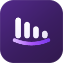
</p>

<h1 align="center">StepUnder</h1>

<p align="center">
  <strong>Deine Musik, dein Server.</strong><br />
  Ein schneller, privater Desktop-Player für Navidrome und Subsonic-kompatible Server.
</p>

<p align="center">
  <a href="https://github.com/Steper158X/StepUnder/releases/latest"></a>
  
  <a href="LICENSE"></a>
</p>

<p align="center">
  <a href="README.md">English</a> · <a href="README.th.md">ภาษาไทย</a> · <a href="README.zh.md">简体中文</a> · <a href="README.es.md">Español</a> · <a href="README.pt.md">Português</a> · <strong>Deutsch</strong> · <a href="README.fr.md">Français</a>
</p>

<p align="center">
  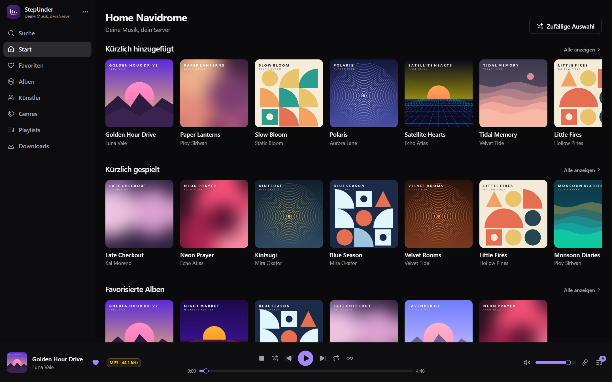
</p>

StepUnder verbindet sich mit dem Musikserver, den du bereits betreibst, und macht
daraus ein ausgefeiltes Hörerlebnis auf dem Desktop — ohne Cloud-Konto, ohne
Telemetrie und ohne Uploads. Alles bleibt zwischen dir und deinem Server.

> [!NOTE]
> StepUnder wird aktiv entwickelt (v0.3.x). Funktionen und Oberfläche können sich noch ändern.

## Inhalt

- [Highlights](#highlights)
- [Screenshots](#screenshots)
- [Funktionen](#funktionen)
- [Tastenkürzel](#tastenkürzel)
- [Installation](#installation)
- [Lizenz](#lizenz)

## Highlights

|                                |                                                                                     |
| ------------------------------ | ----------------------------------------------------------------------------------- |
| 🎵 **Dein eigener Server**     | Navidrome und jeder Subsonic- / OpenSubsonic-Server — wechsle beliebig zwischen mehreren. |
| ⬇️ **Downloads**               | Speichere Songs, Alben und Playlists auf deinem Computer und höre sie offline.     |
| 📻 **Song-Radio**              | Starte aus jedem Titel ein endloses Radio mit ähnlichen Songs.                     |
| 📝 **Vollwertiger Playlist-Editor** | Erstellen, bearbeiten, per Drag & Drop sortieren, eigene Cover, öffentlich oder privat. |
| 🎚️ **Zwei Audio-Engines**      | Integrierter Web-Player oder die mitgelieferte **MPV**-Engine für mehr Formate.    |
| 🎨 **Ganz nach deinem Geschmack** | Dunkles / helles / System-Theme, 7 Akzentfarben, Oberfläche in 7 Sprachen.      |
| 🔄 **Automatische Updates**    | Signierte In-App-Updates direkt aus GitHub Releases.                               |
| 🔒 **Privat by Design**        | Passwörter im Anmeldeinformationsspeicher des Systems. Kein Backend, keine Analysen, keine Telemetrie. |

## Screenshots

<p align="center">
  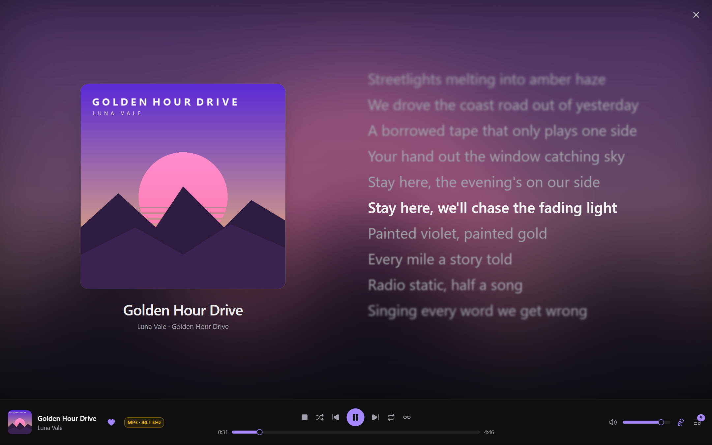
  <br /><sub><b>Wiedergabe</b> — Cover im Vollbild mit synchronisiertem Songtext</sub>
</p>

<table>
  <tr>
    <td width="50%">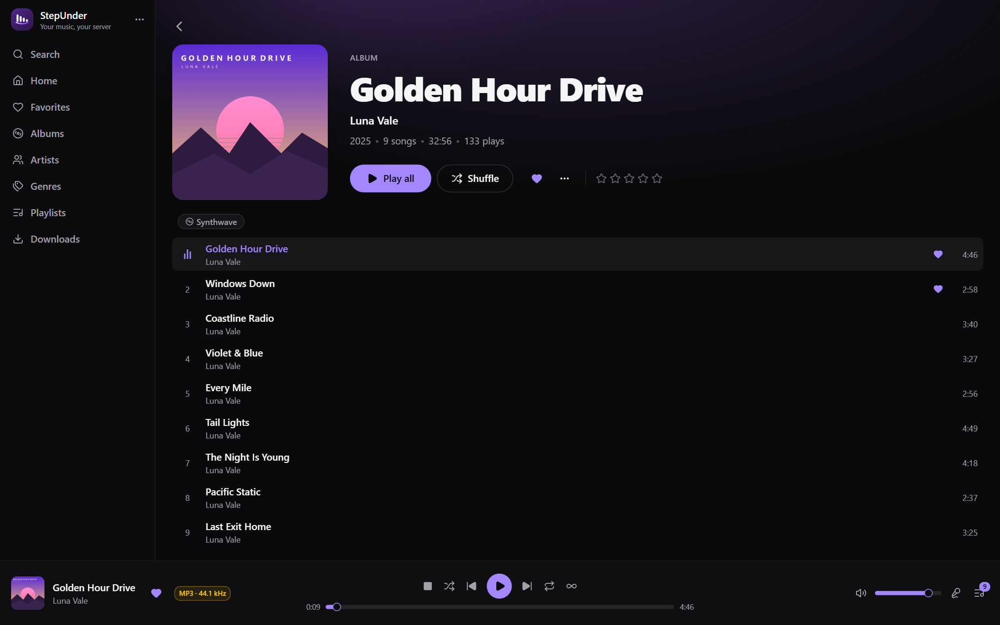<p align="center"><sub><b>Album</b></sub></p></td>
    <td width="50%">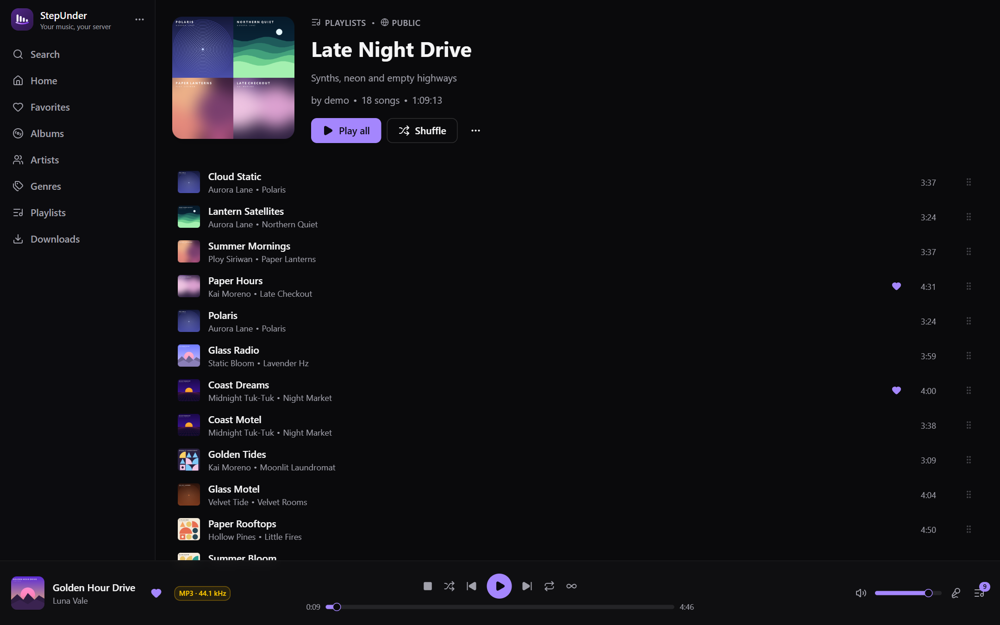<p align="center"><sub><b>Playlist</b> — per Ziehen sortieren</sub></p></td>
  </tr>
  <tr>
    <td width="50%">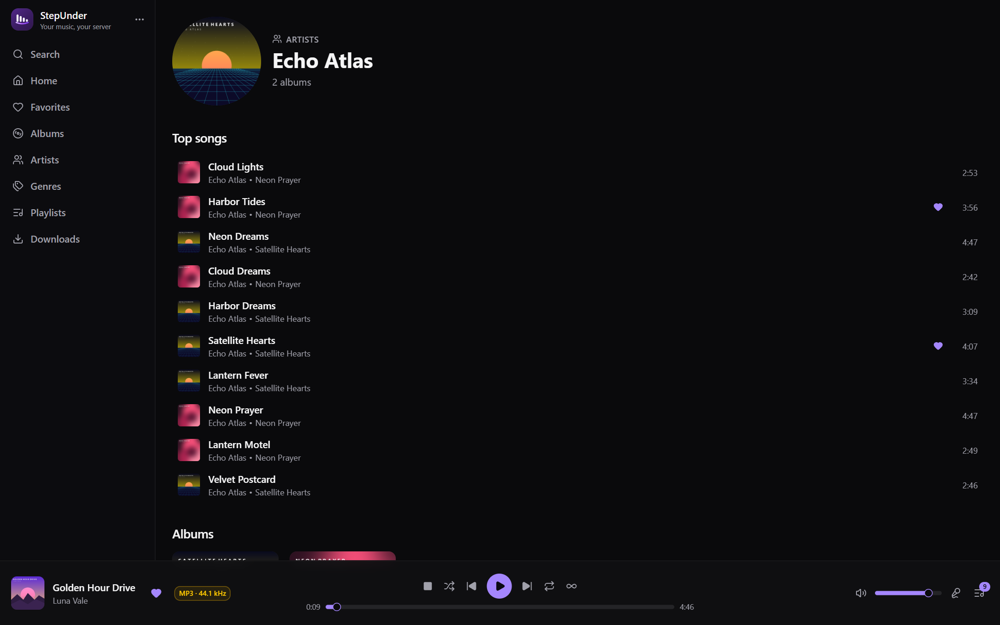<p align="center"><sub><b>Künstler</b></sub></p></td>
    <td width="50%">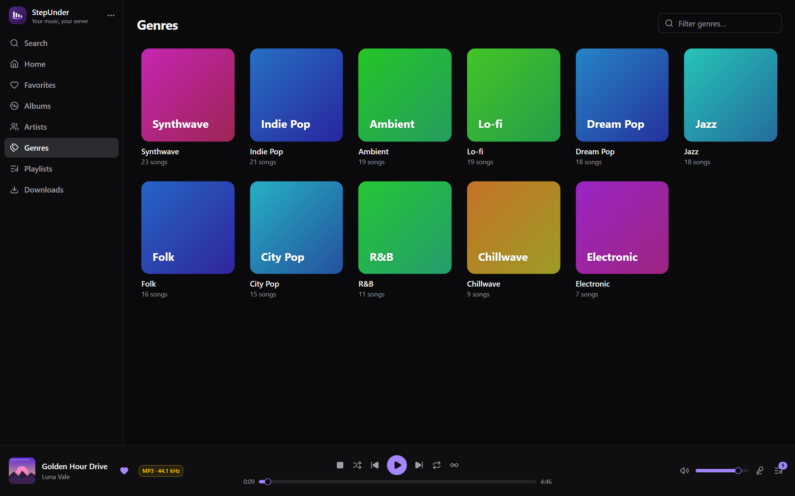<p align="center"><sub><b>Genres</b></sub></p></td>
  </tr>
  <tr>
    <td colspan="2">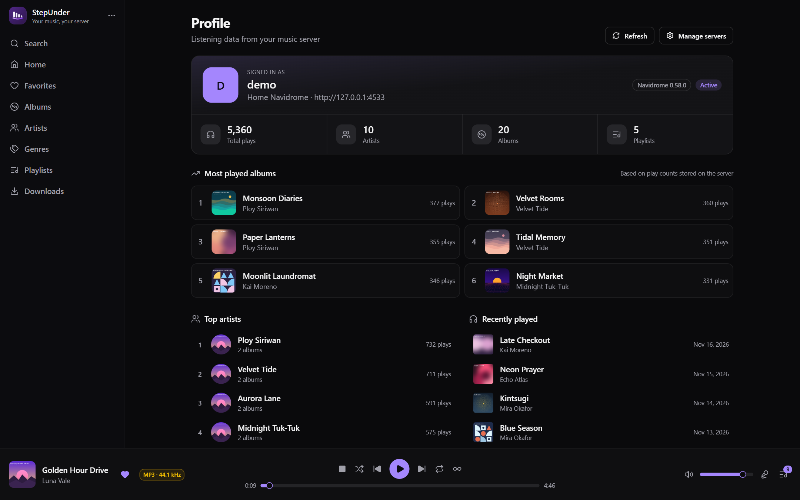<p align="center"><sub><b>Profil</b> — Hörstatistiken von deinem Server</sub></p></td>
  </tr>
</table>

<table>
  <tr>
    <td width="33%">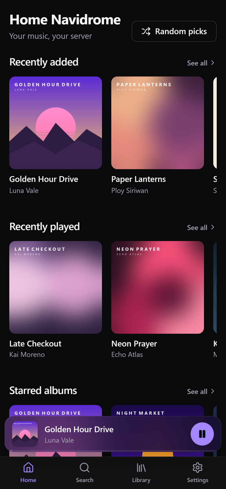</td>
    <td width="33%">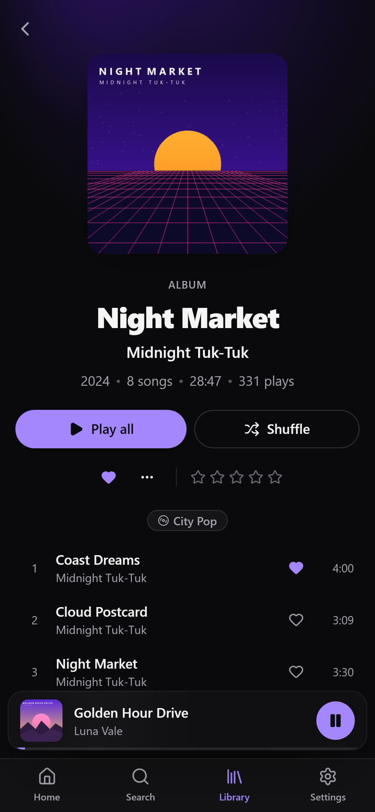</td>
    <td width="33%">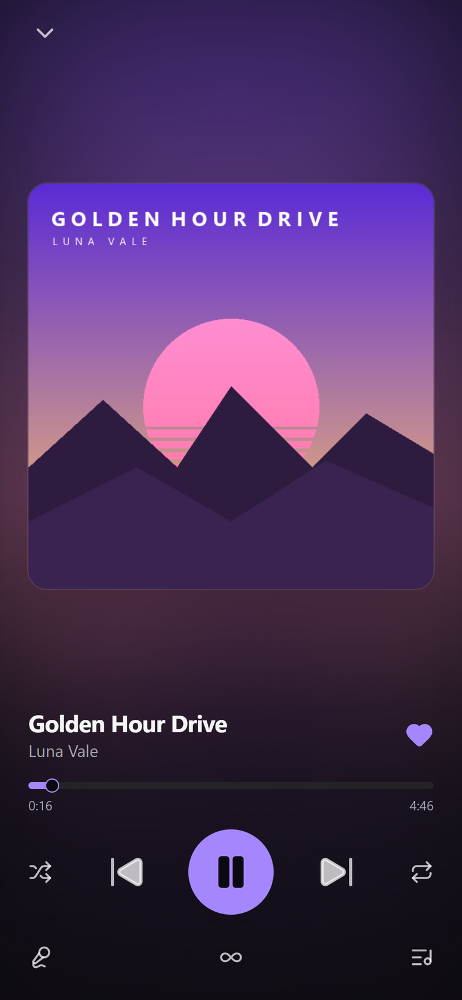</td>
  </tr>
  <tr>
    <td colspan="3"><p align="center"><sub><b>Android</b> — dieselbe Bibliothek, gemacht für dein Smartphone</sub></p></td>
  </tr>
</table>

<sub>Die Screenshots verwenden Demodaten mit generierten Covern.</sub>

## Funktionen

### 📚 Bibliothek

- **Mehrere Server** — speichere mehrere Server und wechsle jederzeit zwischen ihnen.
- **Startseite** — neueste Alben, zuletzt gehört, Zufallsauswahl und deine Favoriten.
- **Alben** — durchsuchen, sortieren und weiterscrollen, um mehr zu laden.
  Albumseiten leuchten in einer Farbe aus dem Cover, zeigen die Wiedergabezahl
  und trennen Alben mit mehreren CDs nach Disc.
- **Bewertungen & Favoriten** — bewerte Songs und Alben mit 1 bis 5 Sternen und
  markiere Alben über das Kontextmenü, oder bewerte ein Album direkt auf seiner Seite.
- **Künstler** — Künstlerseiten mit Bild, Alben und meistgehörten Songs.
- **Genres** — alle Genres durchsuchen, beim Tippen filtern und ein ganzes Genre zufällig abspielen.
- **Favoriten** — alle markierten Songs, Alben und Künstler an einem Ort.
- **Suche** — Songs, Alben und Künstler finden, während du tippst.
- **Profil** — deine Hörstatistiken vom Server: Gesamtwiedergaben, Top-Alben,
  Top-Künstler, meistgehörte Songs und Verlauf.
- **Teilen** — Rechtsklick auf einen Song erstellt einen öffentlichen Link, optional
  mit Ablaufdatum, Beschreibung und Download-Erlaubnis
  (Teilen muss in Navidrome mit `ND_ENABLESHARING=true` aktiviert sein).

### ⬇️ Downloads

- **Alles herunterladen** — Rechtsklick auf einen Song, oder ein ganzes Album bzw. eine Playlist auf einmal.
- **Offline hören** — heruntergeladene Songs werden aus der Datei auf deinem Computer statt per Stream abgespielt.
- **Download-Seite** — alles, was auf diesem Computer gespeichert ist, und was
  noch lädt, mit Wiederholen, Abbrechen und Entfernen.
- **Favoriten herunterladen** — lade einen Song optional herunter, sobald du ihn markierst.
- **Du wählst die Datei** — behalte die Originaldatei oder lass den Server sie in
  ein kleineres Format und eine niedrigere Bitrate umwandeln.
- **Ordner & Speicher** — wähle den Download-Ordner und seine Struktur, und sieh,
  wie viel Platz die Downloads belegen und wie viel auf dem Laufwerk frei ist.

### 🎶 Playlists

- **Erstellen & bearbeiten** — Name, Beschreibung und Sichtbarkeit öffentlich / privat.
- **Eigene Cover** — lade ein JPEG-, PNG-, WebP- oder GIF-Cover hoch (erfordert Navidrome 0.61+).
- **Von überall hinzufügen** — Rechtsklick auf einen beliebigen Song und
  *Zur Playlist hinzufügen* wählen, mit Schnellfilter für die richtige Playlist.
- **Per Ziehen sortieren** — Songs neu anordnen und unerwünschte entfernen.
- **Löschen** von Playlists, die du nicht mehr brauchst.

### ▶️ Wiedergabe

- **Warteschlange** — jetzt abspielen, als Nächstes abspielen, anhängen, entfernen oder leeren.
- **Steuerung** — Zufall, Wiederholen (aus / alle / einer), Spulen, Lautstärke und Stummschaltung.
- **Song-Radio** — erstelle aus jedem Song eine Warteschlange mit ähnlichen Titeln.
- **Dort weitermachen, wo du aufgehört hast** — Warteschlange, aktueller Titel und Position werden pro Server wiederhergestellt.
- **Wiedergabe** — eine Vollbildansicht mit großem Cover und Cover-Viewer.
- **Songtexte** — Songtexte von deinem Server, die bei synchronisierten Texten
  automatisch scrollen. Optional die Zeilen um die gesungene herum weichzeichnen,
  Lautschrift für Japanisch, Koreanisch und Chinesisch anzeigen oder den Text neben
  der Warteschlange behalten.
- **Song-Info** — Titel, Album, Genre, Format, Bitrate, Abtastrate, Bittiefe,
  Kanäle, Dateigröße, Wiedergabezahl, Pfad und mehr.
- **Zwei Wiedergabe-Engines** — integrierter Web-Player oder MPV für mehr Formate.
- **Audioausgabe** — wähle, welcher Lautsprecher oder Kopfhörer genutzt wird.
- **Streaming-Qualität** — Originaldatei oder Transkodierung zu MP3 / AAC / Opus / FLAC
  mit optionaler Bitrate-Grenze.
- **Scrobbling** — Wiedergaben an deinen Server melden, oder ausschalten.
- **Discord Rich Presence** — optional anzeigen, was du gerade hörst.

### 🖥️ Desktop-Erlebnis

- **Eigene Titelleiste** mit einem aufgeräumten, nativ wirkenden Fenster.
- **Einzelinstanz** — ein erneuter Start holt das bereits geöffnete Fenster nach vorne.
- **Sauberer Lautstärkemixer** — erscheint als ein einziger *StepUnder*-Eintrag im Windows-Lautstärkemixer.
- **Automatische Updates** — beim Start oder manuell prüfen, mit Versionshinweisen und Download-Fortschritt.
- **Cover-Cache** — Cover werden auf der Festplatte gespeichert und laden sofort,
  auch nach einem Neustart. Lege die maximale Größe und die Aktualisierungshäufigkeit
  fest oder leere den Cache unter **Einstellungen → Cache**.
- **Sparsam mit Speicher** — Seiten laden erst beim Öffnen, lange Listen und die
  Warteschlange zeichnen nur die sichtbaren Zeilen, und unter Windows gibt die App
  im Hintergrund Speicher frei.

### 🎨 Personalisierung

- **Sprachen** — Englisch, Thai, vereinfachtes Chinesisch, Spanisch, Portugiesisch, Deutsch und Französisch, jederzeit umschaltbar.
- **Themes** — dunkel, hell oder wie das System.
- **Liquid Glass** — durchscheinende Glas-Panels mit einstellbarer Unschärfe; unter
  Windows kann das Fenster selbst durchsichtig sein (Acrylic oder Mica).
- **Player-Layout** — Player-Leiste fest unten oder schwebend über dem Inhalt.
- **Akzentfarben** — Lila, Blau, Türkis, Grün, Orange, Rot oder Pink.
- **Schriftarten** — Systemschrift oder Sarabun für schönen thailändischen Text.

### 🔒 Datenschutz & Sicherheit

- Passwörter werden im Anmeldeinformationsspeicher deines Betriebssystems gespeichert, niemals in einer Klartext-Einstellungsdatei.
- Deine Musik und dein Konto bleiben auf deinem Server. StepUnder hat kein Backend, keine Analysen und keine Telemetrie.

## Tastenkürzel

| Taste                | Aktion                         |
| -------------------- | ------------------------------ |
| `Space`              | Abspielen / Pause              |
| `←` / `→`            | Zurück- / Vorspulen            |
| `↑` / `↓`            | Lauter / leiser                |
| `Shift` + `←` / `→`  | Vorheriger / nächster Titel    |
| `Esc`                | Vollbildansicht schließen      |

## Installation

1. Lade das neueste Installationsprogramm von der
   [**Releases-Seite**](https://github.com/Steper158X/StepUnder/releases/latest) herunter.
2. Führe die Installation aus und starte **StepUnder**.
3. Gib Server-URL, Benutzername und Passwort ein — und los geht's.

Danach hält sich StepUnder automatisch auf dem neuesten Stand.

### Android

Lade `StepUnder_<version>_android.apk` von der
[**Releases-Seite**](https://github.com/Steper158X/StepUnder/releases/latest)
herunter und öffne die Datei auf deinem Smartphone, um sie zu installieren
(erlaube Installationen aus deinem Browser oder Dateimanager, falls Android
danach fragt). Die Android-App hat ein Smartphone-Layout, spielt im Hintergrund
weiter mit Steuerung in der Benachrichtigung und lässt dich die Audioausgabe
wählen (Lautsprecher, Bluetooth, Kabel oder USB). Die App sucht beim Start (oder
unter **Einstellungen → Über**) auf GitHub nach neuen Versionen und öffnet die neuere
APK, die du über die alte installierst.

### Linux (Ubuntu, Pop!_OS)

Die Builds richten sich an Ubuntu 22.04 / Pop!_OS 22.04 und neuer (x86_64).

- **.deb** (empfohlen): lade `StepUnder_<version>_amd64.deb` herunter und führe dann aus:

  ```bash
  sudo apt install ./StepUnder_*_amd64.deb
  ```

- **AppImage**: lade `StepUnder_<version>_amd64.AppImage` herunter, mache es
  ausführbar (`chmod +x StepUnder_*.AppImage`) und starte es. Das AppImage
  aktualisiert sich selbst über **Einstellungen → Updates**.

Der MPV-Player funktioniert sofort: Das `.deb` installiert libmpv als
Abhängigkeit, und das AppImage bringt eine eigene Kopie mit. Gespeicherte
Passwörter landen im GNOME Keyring. Mica/Acrylic-Fenstereffekte gibt es nur unter
Windows. Mit dem proprietären NVIDIA-Treiber setzt StepUnder
`WEBKIT_DISABLE_DMABUF_RENDERER=1` automatisch. Falls das Fenster trotzdem leer
bleibt, starte es mit `WEBKIT_DISABLE_DMABUF_RENDERER=1` (oder zusätzlich
`WEBKIT_DISABLE_COMPOSITING_MODE=1`).

### Aus dem Quellcode bauen unter Linux

```bash
sudo apt install libwebkit2gtk-4.1-dev libgtk-3-dev libayatana-appindicator3-dev librsvg2-dev libssl-dev libdbus-1-dev pkg-config patchelf build-essential
```

Danach `bun install` und `bun run tauri build` (oder `bun run tauri dev`).

## Lizenz

Veröffentlicht unter der [MIT-Lizenz](LICENSE).
