<p align="center">
  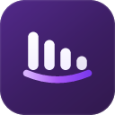
</p>

<h1 align="center">StepUnder</h1>

<p align="center">
  <strong>Tu música, tu servidor.</strong><br />
  Un reproductor de escritorio rápido y privado para Navidrome y servidores compatibles con Subsonic.
</p>

<p align="center">
  <a href="https://github.com/Steper158X/StepUnder/releases/latest"></a>
  
  <a href="LICENSE"></a>
</p>

<p align="center">
  <a href="README.md">English</a> · <a href="README.th.md">ภาษาไทย</a> · <a href="README.zh.md">简体中文</a> · <strong>Español</strong> · <a href="README.pt.md">Português</a> · <a href="README.de.md">Deutsch</a> · <a href="README.fr.md">Français</a>
</p>

<p align="center">
  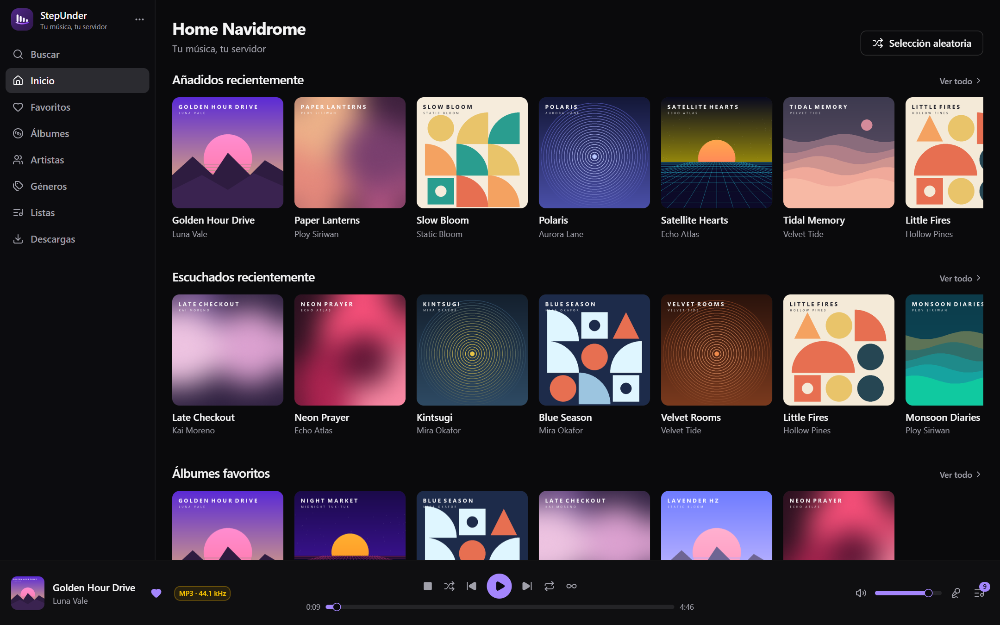
</p>

StepUnder se conecta al servidor de música que ya tienes y lo convierte en una
experiencia de escucha de escritorio pulida: sin cuenta en la nube, sin telemetría
y sin subir nada. Todo queda entre tú y tu servidor.

> [!NOTE]
> StepUnder está en desarrollo activo (v0.2.x). Las funciones y la interfaz aún pueden cambiar.

## Contenido

- [Lo más destacado](#lo-más-destacado)
- [Capturas](#capturas)
- [Funciones](#funciones)
- [Atajos de teclado](#atajos-de-teclado)
- [Instalación](#instalación)
- [Licencia](#licencia)

## Lo más destacado

|                               |                                                                                        |
| ----------------------------- | -------------------------------------------------------------------------------------- |
| 🎵 **Tu propio servidor**     | Navidrome y cualquier servidor Subsonic / OpenSubsonic; cambia entre varios cuando quieras. |
| ⬇️ **Descargas**              | Guarda canciones, álbumes y listas en tu equipo y escúchalas sin conexión.            |
| 📻 **Radio de canción**       | Inicia una radio infinita de canciones similares desde cualquier pista.               |
| 📝 **Editor de listas completo** | Crea, edita, reordena arrastrando, pon portadas propias, públicas o privadas.      |
| 🎚️ **Dos motores de audio**   | Reproductor web integrado o el motor **MPV** incluido para más formatos.              |
| 🎨 **A tu manera**            | Tema oscuro / claro / del sistema, 7 colores de acento, interfaz en 7 idiomas.        |
| 🔄 **Actualizaciones automáticas** | Actualizaciones firmadas dentro de la app, directamente desde GitHub Releases.   |
| 🔒 **Privado por diseño**     | Contraseñas en el almacén de credenciales del sistema. Sin backend, sin analíticas, sin telemetría. |

## Capturas

<p align="center">
  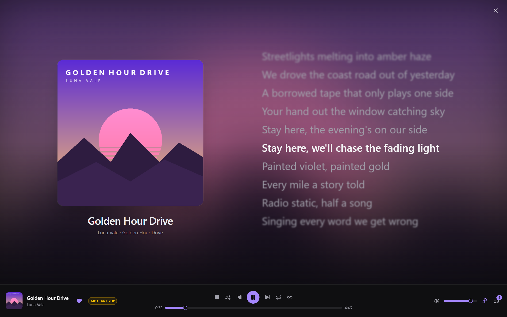
  <br /><sub><b>Reproduciendo</b> — portada a pantalla completa con letra sincronizada</sub>
</p>

<table>
  <tr>
    <td width="50%">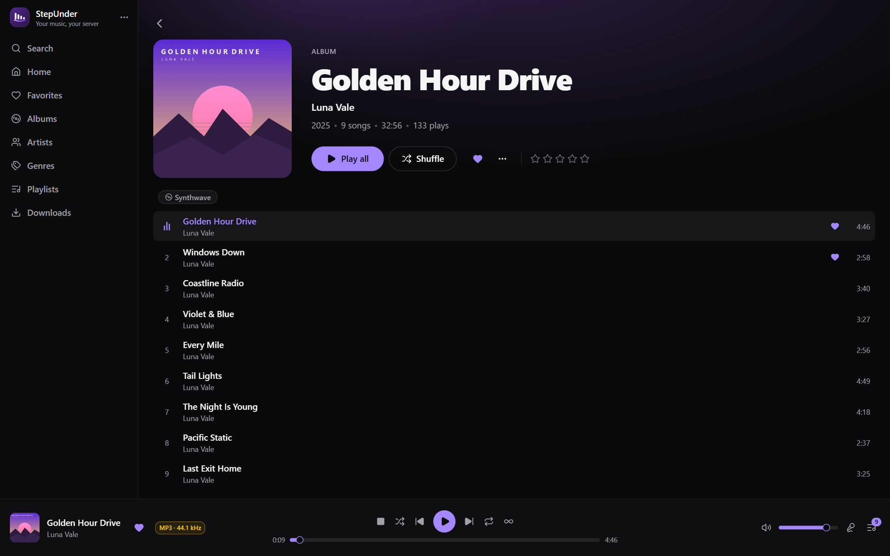<p align="center"><sub><b>Álbum</b></sub></p></td>
    <td width="50%">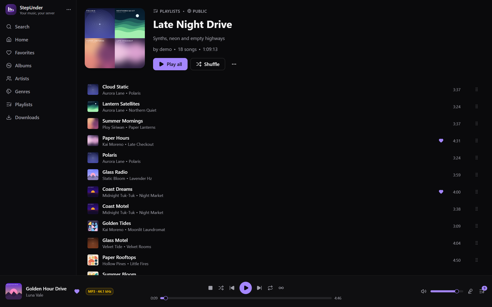<p align="center"><sub><b>Lista</b> — arrastra para reordenar</sub></p></td>
  </tr>
  <tr>
    <td width="50%">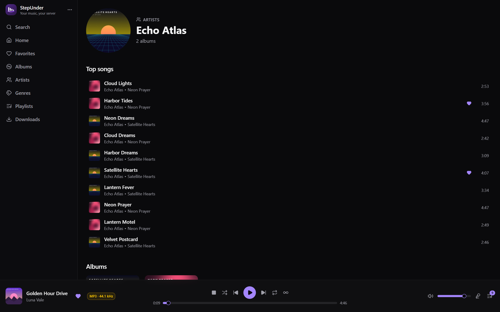<p align="center"><sub><b>Artista</b></sub></p></td>
    <td width="50%">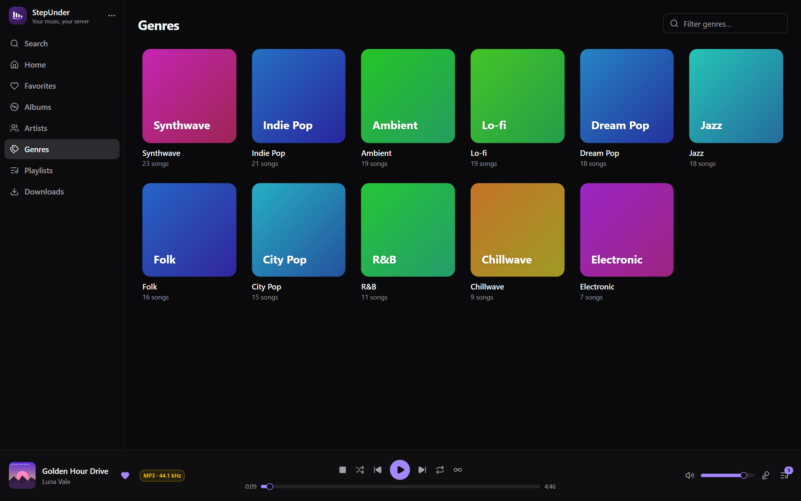<p align="center"><sub><b>Géneros</b></sub></p></td>
  </tr>
  <tr>
    <td colspan="2">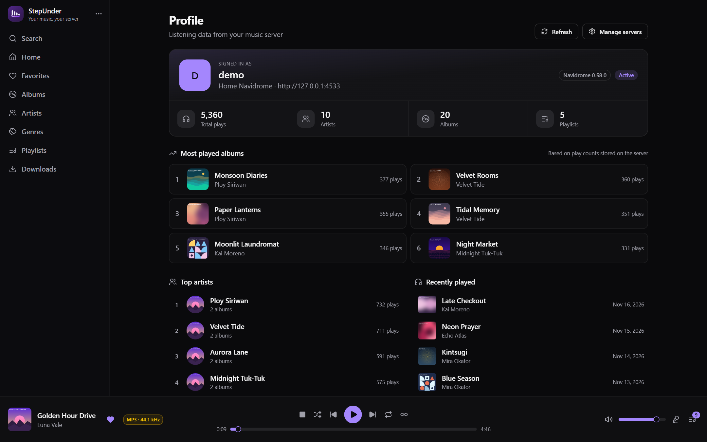<p align="center"><sub><b>Perfil</b> — estadísticas de escucha de tu servidor</sub></p></td>
  </tr>
</table>

<table>
  <tr>
    <td width="33%">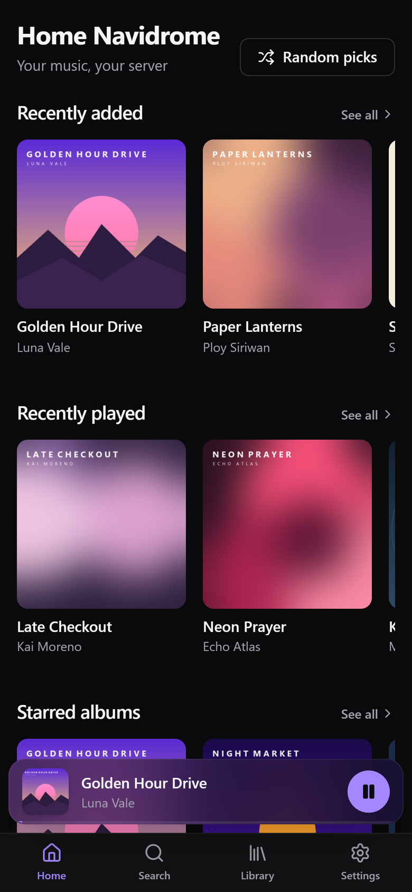</td>
    <td width="33%">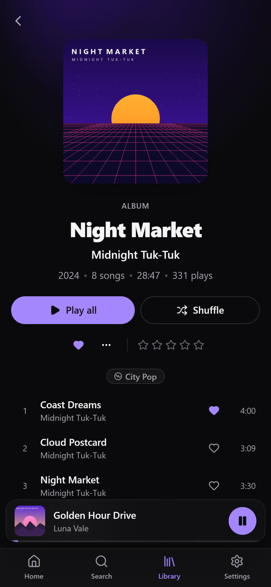</td>
    <td width="33%">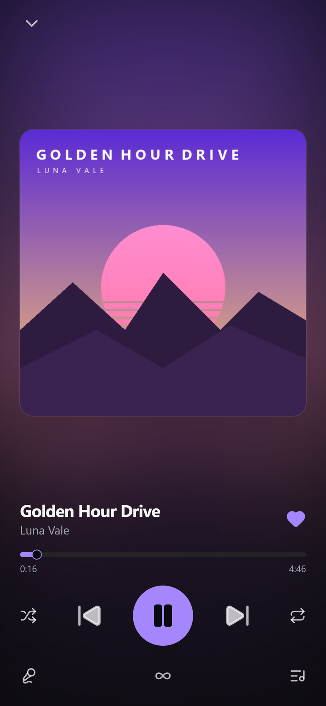</td>
  </tr>
  <tr>
    <td colspan="3"><p align="center"><sub><b>Android</b> — la misma biblioteca, hecha para tu teléfono</sub></p></td>
  </tr>
</table>

<sub>Las capturas usan datos de demostración con portadas generadas.</sub>

## Funciones

### 📚 Biblioteca

- **Varios servidores** — guarda varios servidores y cambia entre ellos cuando quieras.
- **Inicio** — álbumes más nuevos, escuchados recientemente, selección aleatoria y tus favoritos.
- **Álbumes** — explora, ordena y sigue desplazándote para cargar más. Las páginas
  de álbum brillan con un color tomado de la portada, muestran el número de
  reproducciones y separan los álbumes de varios discos.
- **Valoraciones y favoritos** — valora canciones y álbumes de 1 a 5 estrellas y
  marca álbumes desde el menú contextual, o valora un álbum en su propia página.
- **Artistas** — páginas de artista con imagen, álbumes y canciones más escuchadas.
- **Géneros** — explora todos los géneros, filtra mientras escribes y reproduce un género entero en aleatorio.
- **Favoritos** — todas tus canciones, álbumes y artistas marcados en un solo lugar.
- **Búsqueda** — encuentra canciones, álbumes y artistas mientras escribes.
- **Perfil** — tus estadísticas de escucha del servidor: reproducciones totales,
  álbumes y artistas principales, canciones más escuchadas e historial reciente.
- **Compartir** — haz clic derecho en una canción para crear un enlace público,
  con caducidad, descripción y permiso de descarga opcionales
  (requiere activar el uso compartido en Navidrome con `ND_ENABLESHARING=true`).

### ⬇️ Descargas

- **Descarga lo que quieras** — clic derecho en una canción, o descarga un álbum o una lista completa de una vez.
- **Escucha sin conexión** — las canciones descargadas se reproducen desde el archivo en tu equipo en lugar de por streaming.
- **Página de descargas** — todo lo guardado en este equipo y lo que aún se está
  descargando, con reintentar, cancelar y eliminar.
- **Descargar favoritos** — opcionalmente, descarga una canción en cuanto la marcas.
- **Tú eliges el archivo** — conserva el archivo original o deja que el servidor
  lo convierta a un formato y una tasa de bits más pequeños.
- **Carpeta y almacenamiento** — elige la carpeta de descargas y su estructura, y
  mira cuánto espacio ocupan y cuánto queda libre en el disco.

### 🎶 Listas de reproducción

- **Crear y editar** — nombre, descripción y visibilidad pública / privada.
- **Portadas propias** — sube una portada JPEG, PNG, WebP o GIF (requiere Navidrome 0.61+).
- **Añadir desde cualquier sitio** — clic derecho en cualquier canción y elige
  *Añadir a la lista*, con un filtro rápido para encontrar la correcta.
- **Arrastra para reordenar** — reorganiza canciones y quita las que no quieras.
- **Elimina** las listas que ya no necesites.

### ▶️ Reproducción

- **Cola** — reproducir ahora, reproducir a continuación, añadir a la cola, quitar o vaciar.
- **Controles** — aleatorio, repetir (no / todo / una), avanzar, volumen y silencio.
- **Radio de canción** — crea una cola de pistas similares a partir de cualquier canción.
- **Continúa donde lo dejaste** — la cola, la pista actual y la posición se restauran por servidor.
- **Reproduciendo** — vista a pantalla completa con portada grande y visor de portadas.
- **Letras** — letras de tu servidor, con desplazamiento automático si están sincronizadas.
  Opcionalmente difumina las líneas alrededor de la que se canta, muestra lecturas
  fonéticas para japonés, coreano y chino, o deja la letra junto a la cola.
- **Información de la canción** — título, álbum, género, formato, tasa de bits,
  frecuencia de muestreo, profundidad de bits, canales, tamaño, reproducciones, ruta y más.
- **Dos motores de reproducción** — reproductor web integrado o MPV para más formatos.
- **Salida de audio** — elige qué altavoz o auriculares usar.
- **Calidad de streaming** — archivo original o transcodificación a MP3 / AAC / Opus / FLAC
  con límite de tasa de bits opcional.
- **Scrobbling** — informa de las reproducciones a tu servidor, o desactívalo.
- **Discord Rich Presence** — muestra opcionalmente lo que estás escuchando.

### 🖥️ Experiencia de escritorio

- **Barra de título personalizada** con una ventana limpia y de aspecto nativo.
- **Instancia única** — al abrir la app de nuevo se enfoca la ventana ya abierta.
- **Mezclador de volumen limpio** — aparece como una sola entrada *StepUnder* en el mezclador de volumen de Windows.
- **Actualizaciones automáticas** — comprueba al iniciar o manualmente, con notas de versión y progreso de descarga.
- **Caché de portadas** — las portadas se guardan en disco para cargar al instante,
  incluso tras reiniciar. Define el tamaño máximo y la frecuencia de actualización,
  o vacía la caché en **Ajustes → Caché**.

### 🎨 Personalización

- **Idiomas** — inglés, tailandés, chino simplificado, español, portugués, alemán y francés, intercambiables en cualquier momento.
- **Temas** — oscuro, claro o según el sistema.
- **Liquid Glass** — paneles de vidrio translúcido con desenfoque ajustable; en
  Windows la propia ventana puede ser transparente (Acrylic o Mica).
- **Disposición del reproductor** — barra fija abajo o flotando sobre el contenido.
- **Colores de acento** — morado, azul, turquesa, verde, naranja, rojo o rosa.
- **Fuentes** — fuente del sistema o Sarabun para un texto tailandés precioso.

### 🔒 Privacidad y seguridad

- Las contraseñas se guardan en el almacén de credenciales del sistema operativo, nunca en un archivo de ajustes en texto plano.
- Tu música y tu cuenta se quedan en tu servidor. StepUnder no tiene backend, ni analíticas, ni telemetría.

## Atajos de teclado

| Tecla                | Acción                              |
| -------------------- | ----------------------------------- |
| `Space`              | Reproducir / pausar                 |
| `←` / `→`            | Retroceder / avanzar                |
| `↑` / `↓`            | Subir / bajar volumen               |
| `Shift` + `←` / `→`  | Pista anterior / siguiente          |
| `Esc`                | Cerrar la vista a pantalla completa |

## Instalación

1. Descarga el instalador más reciente desde la
   [**página de Releases**](https://github.com/Steper158X/StepUnder/releases/latest).
2. Ejecuta el instalador y abre **StepUnder**.
3. Introduce la URL de tu servidor, usuario y contraseña, y empieza a escuchar.

A partir de ahí, StepUnder se mantiene actualizado automáticamente.

### Android

Descarga `StepUnder_<version>_android.apk` desde la
[**página de Releases**](https://github.com/Steper158X/StepUnder/releases/latest)
y ábrelo en tu teléfono para instalarlo (permite la instalación desde tu navegador
o gestor de archivos si Android lo pide). La app de Android tiene un diseño para
móvil, sigue sonando en segundo plano con controles en la notificación y te deja
elegir la salida de audio (altavoz, Bluetooth, cable o USB). Para actualizar,
instala el APK más nuevo de la página de Releases sobre el anterior.

### Linux (Ubuntu, Pop!_OS)

Las compilaciones están pensadas para Ubuntu 22.04 / Pop!_OS 22.04 o posterior (x86_64).

- **.deb** (recomendado): descarga `StepUnder_<version>_amd64.deb` y luego

  ```bash
  sudo apt install ./StepUnder_*_amd64.deb
  ```

- **AppImage**: descarga `StepUnder_<version>_amd64.AppImage`, hazlo ejecutable
  (`chmod +x StepUnder_*.AppImage`) y ejecútalo. El AppImage se actualiza solo
  desde **Ajustes → Actualizaciones**.

El reproductor MPV funciona sin configuración: el `.deb` instala libmpv como
dependencia y el AppImage lleva su propia copia. Las contraseñas guardadas van a
GNOME Keyring. Los efectos de ventana Mica/Acrylic son solo para Windows. Con el
controlador propietario de NVIDIA, StepUnder establece
`WEBKIT_DISABLE_DMABUF_RENDERER=1` por ti. Si la ventana sigue abriéndose en blanco,
iníciala con `WEBKIT_DISABLE_DMABUF_RENDERER=1` (o también
`WEBKIT_DISABLE_COMPOSITING_MODE=1`).

### Compilar desde el código en Linux

```bash
sudo apt install libwebkit2gtk-4.1-dev libgtk-3-dev libayatana-appindicator3-dev librsvg2-dev libssl-dev libdbus-1-dev pkg-config patchelf build-essential
```

Después, `bun install` y `bun run tauri build` (o `bun run tauri dev`).

## Licencia

Publicado bajo la [licencia MIT](LICENSE).
