<p align="center">
  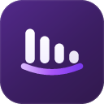
</p>

<h1 align="center">StepUnder</h1>

<p align="center">
  <strong>Votre musique, votre serveur.</strong><br />
  Un lecteur de bureau rapide et respectueux de la vie privée pour Navidrome et les serveurs compatibles Subsonic.
</p>

<p align="center">
  <a href="https://github.com/Steper158X/StepUnder/releases/latest"></a>
  
  <a href="LICENSE"></a>
</p>

<p align="center">
  <a href="README.md">English</a> · <a href="README.th.md">ภาษาไทย</a> · <a href="README.zh.md">简体中文</a> · <a href="README.es.md">Español</a> · <a href="README.pt.md">Português</a> · <a href="README.de.md">Deutsch</a> · <strong>Français</strong>
</p>

<p align="center">
  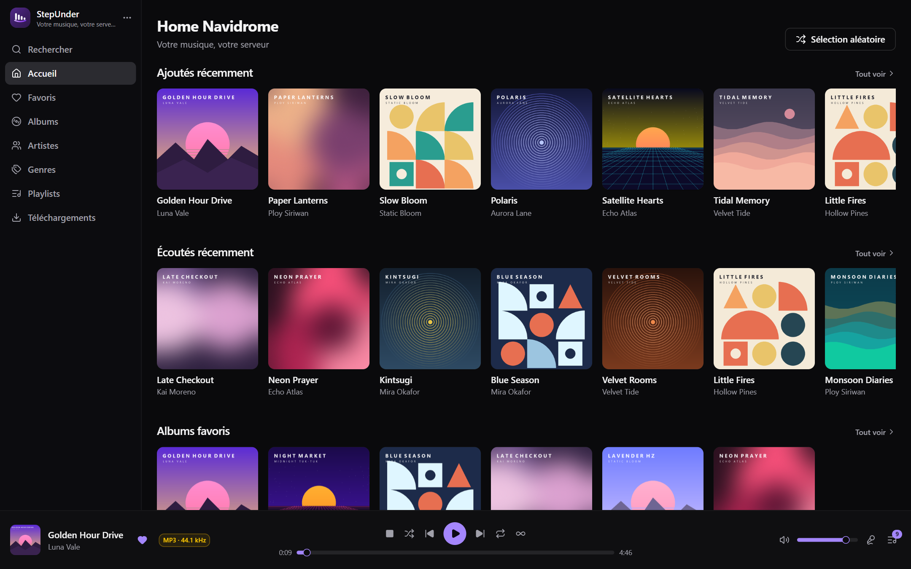
</p>

StepUnder se connecte au serveur de musique que vous utilisez déjà et le
transforme en une expérience d'écoute soignée sur ordinateur — sans compte cloud,
sans télémétrie et sans envoi de fichiers. Tout reste entre vous et votre serveur.

> [!NOTE]
> StepUnder est en développement actif (v0.2.x). Les fonctionnalités et l'interface peuvent encore évoluer.

## Sommaire

- [Points forts](#points-forts)
- [Captures](#captures)
- [Fonctionnalités](#fonctionnalités)
- [Raccourcis clavier](#raccourcis-clavier)
- [Installation](#installation)
- [Licence](#licence)

## Points forts

|                                   |                                                                                      |
| --------------------------------- | ------------------------------------------------------------------------------------ |
| 🎵 **Votre propre serveur**       | Navidrome et tout serveur Subsonic / OpenSubsonic — passez de l'un à l'autre à volonté. |
| ⬇️ **Téléchargements**            | Enregistrez titres, albums et playlists sur votre ordinateur et écoutez-les hors ligne. |
| 📻 **Radio de titre**             | Lancez une radio infinie de titres similaires à partir de n'importe quel morceau.    |
| 📝 **Éditeur de playlists complet** | Créez, modifiez, réordonnez par glisser-déposer, ajoutez vos pochettes, publiques ou privées. |
| 🎚️ **Deux moteurs audio**         | Lecteur web intégré ou moteur **MPV** fourni pour davantage de formats.              |
| 🎨 **À votre image**              | Thème sombre / clair / système, 7 couleurs d'accent, interface en 7 langues.         |
| 🔄 **Mises à jour automatiques**  | Mises à jour signées dans l'application, directement depuis GitHub Releases.         |
| 🔒 **Privé par conception**       | Mots de passe dans le coffre d'identifiants du système. Pas de backend, pas d'analyses, pas de télémétrie. |

## Captures

<p align="center">
  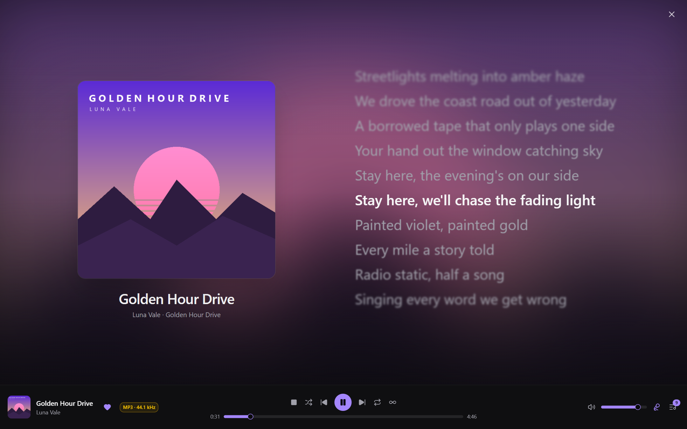
  <br /><sub><b>Lecture en cours</b> — pochette plein écran avec paroles synchronisées</sub>
</p>

<table>
  <tr>
    <td width="50%">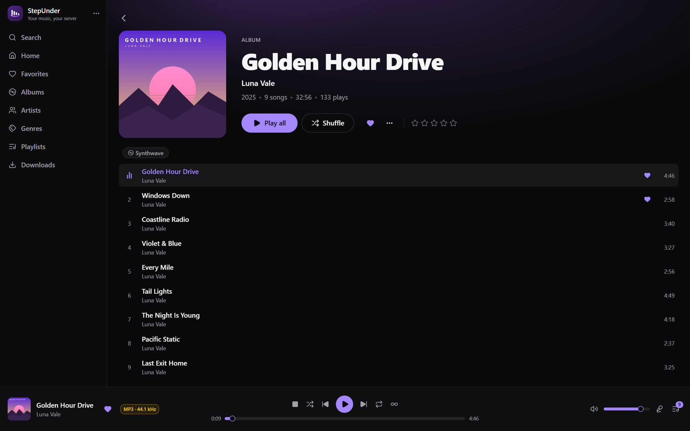<p align="center"><sub><b>Album</b></sub></p></td>
    <td width="50%">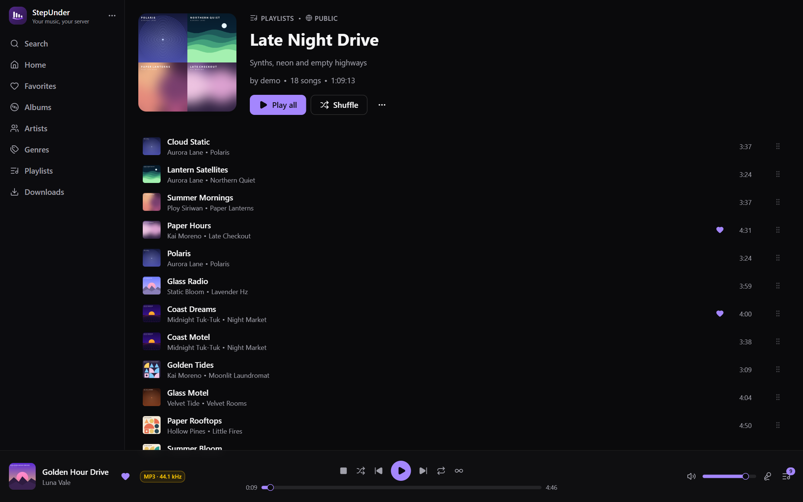<p align="center"><sub><b>Playlist</b> — glisser pour réordonner</sub></p></td>
  </tr>
  <tr>
    <td width="50%">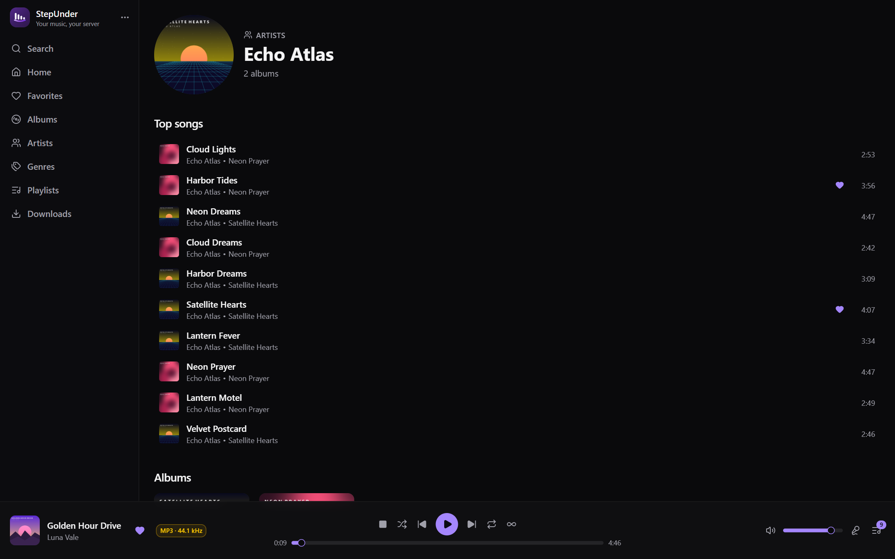<p align="center"><sub><b>Artiste</b></sub></p></td>
    <td width="50%">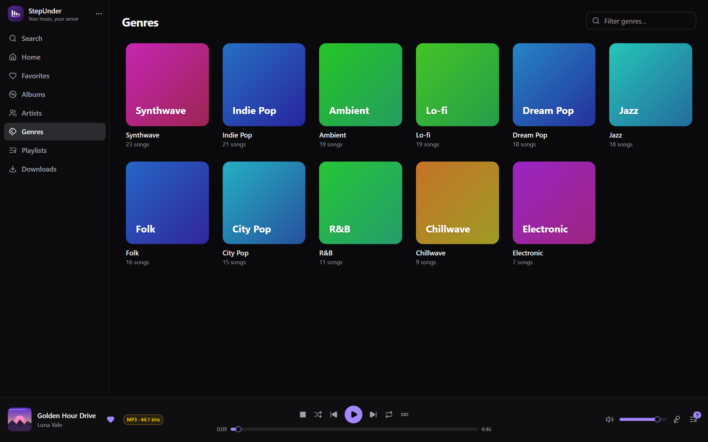<p align="center"><sub><b>Genres</b></sub></p></td>
  </tr>
  <tr>
    <td colspan="2">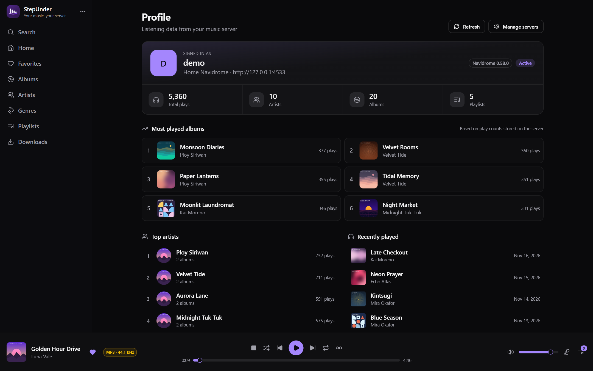<p align="center"><sub><b>Profil</b> — statistiques d'écoute de votre serveur</sub></p></td>
  </tr>
</table>

<table>
  <tr>
    <td width="33%">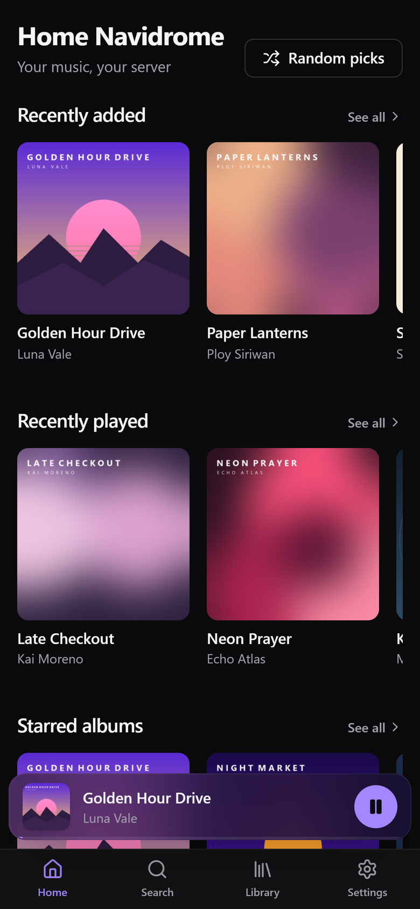</td>
    <td width="33%">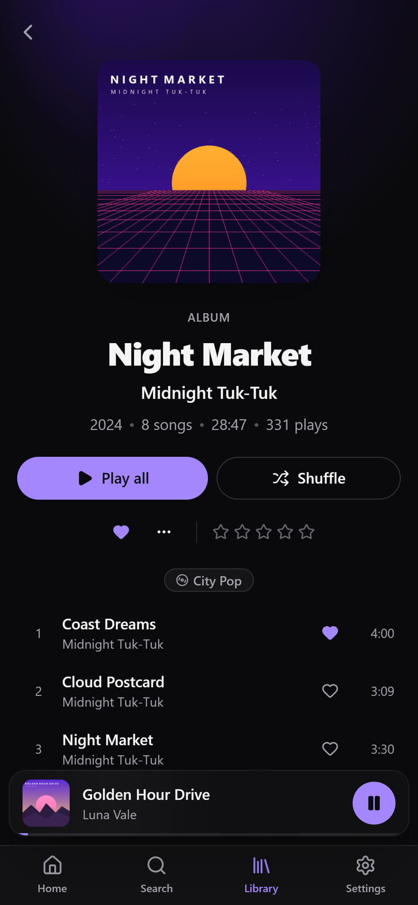</td>
    <td width="33%">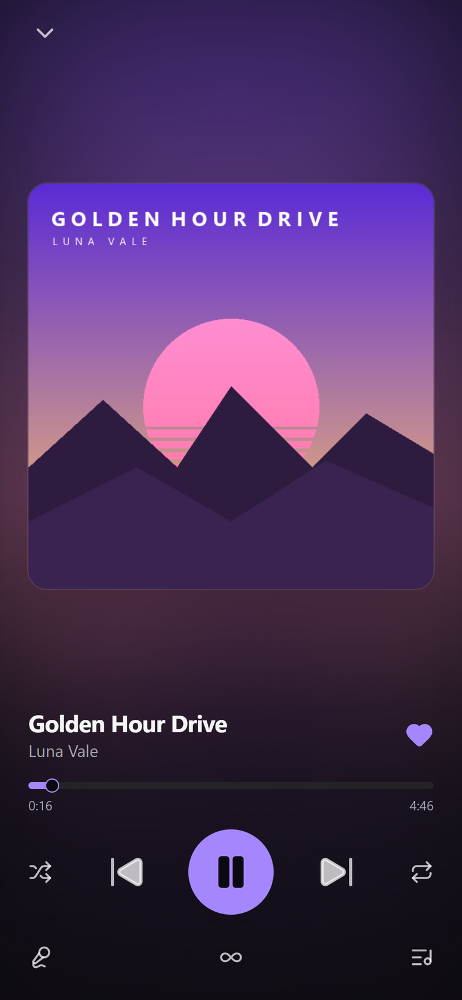</td>
  </tr>
  <tr>
    <td colspan="3"><p align="center"><sub><b>Android</b> — la même bibliothèque, pensée pour votre téléphone</sub></p></td>
  </tr>
</table>

<sub>Les captures utilisent des données de démonstration avec des pochettes générées.</sub>

## Fonctionnalités

### 📚 Bibliothèque

- **Plusieurs serveurs** — enregistrez plusieurs serveurs et passez de l'un à l'autre à tout moment.
- **Accueil** — derniers albums, écoutés récemment, sélection aléatoire et vos favoris.
- **Albums** — parcourez, triez et continuez à défiler pour en charger davantage.
  Les pages d'album s'illuminent d'une couleur tirée de la pochette, affichent le
  nombre d'écoutes et séparent les albums multi-disques par disque.
- **Notes et favoris** — notez titres et albums de 1 à 5 étoiles et ajoutez des
  albums aux favoris depuis le menu contextuel, ou notez un album directement sur sa page.
- **Artistes** — pages d'artiste avec image, albums et titres les plus écoutés.
- **Genres** — parcourez tous les genres, filtrez à la frappe et lancez un genre entier en aléatoire.
- **Favoris** — tous vos titres, albums et artistes favoris au même endroit.
- **Recherche** — trouvez titres, albums et artistes pendant la saisie.
- **Profil** — vos statistiques d'écoute depuis le serveur : écoutes totales,
  albums et artistes préférés, titres les plus écoutés et historique récent.
- **Partage** — clic droit sur un titre pour créer un lien public, avec date
  d'expiration, description et autorisation de téléchargement facultatives
  (nécessite d'activer le partage dans Navidrome avec `ND_ENABLESHARING=true`).

### ⬇️ Téléchargements

- **Téléchargez tout** — clic droit sur un titre, ou téléchargez un album ou une playlist entière d'un coup.
- **Écoute hors ligne** — les titres téléchargés sont lus depuis le fichier sur votre ordinateur au lieu d'être diffusés.
- **Page des téléchargements** — tout ce qui est enregistré sur cet ordinateur et
  ce qui est encore en cours, avec réessayer, annuler et supprimer.
- **Télécharger les favoris** — téléchargez éventuellement un titre dès que vous l'ajoutez aux favoris.
- **Vous choisissez le fichier** — conservez le fichier d'origine ou laissez le
  serveur le convertir dans un format et un débit plus légers.
- **Dossier et stockage** — choisissez le dossier de téléchargement et son
  organisation, et voyez l'espace utilisé et l'espace libre sur le disque.

### 🎶 Playlists

- **Créer et modifier** — nom, description et visibilité publique / privée.
- **Pochettes personnalisées** — importez une pochette JPEG, PNG, WebP ou GIF (nécessite Navidrome 0.61+).
- **Ajout depuis n'importe où** — clic droit sur n'importe quel titre puis
  *Ajouter à la playlist*, avec un filtre rapide pour trouver la bonne.
- **Glisser pour réordonner** — réorganisez les titres et retirez ceux dont vous ne voulez pas.
- **Supprimez** les playlists dont vous n'avez plus besoin.

### ▶️ Lecture

- **File d'attente** — lire maintenant, lire ensuite, ajouter à la file, retirer ou vider.
- **Commandes** — aléatoire, répétition (non / tout / un), avance, volume et sourdine.
- **Radio de titre** — créez une file de titres similaires à partir de n'importe quel morceau.
- **Reprenez où vous en étiez** — la file, le titre en cours et la position sont restaurés pour chaque serveur.
- **Lecture en cours** — une vue plein écran avec grande pochette et visionneuse de pochettes.
- **Paroles** — paroles depuis votre serveur, avec défilement automatique lorsqu'elles
  sont synchronisées. Vous pouvez flouter les lignes autour de celle qui est chantée,
  afficher la lecture phonétique du japonais, du coréen et du chinois, ou garder les
  paroles à côté de la file d'attente.
- **Infos sur le titre** — titre, album, genre, format, débit, fréquence
  d'échantillonnage, profondeur de bits, canaux, taille, nombre d'écoutes, chemin, etc.
- **Deux moteurs de lecture** — lecteur web intégré, ou MPV pour davantage de formats.
- **Sortie audio** — choisissez l'enceinte ou le casque à utiliser.
- **Qualité du streaming** — fichier d'origine, ou transcodage en MP3 / AAC / Opus / FLAC
  avec plafond de débit facultatif.
- **Scrobbling** — signalez les écoutes à votre serveur, ou désactivez-le.
- **Discord Rich Presence** — affichez éventuellement ce que vous écoutez.

### 🖥️ Expérience de bureau

- **Barre de titre personnalisée** avec une fenêtre épurée et d'aspect natif.
- **Instance unique** — relancer l'application met au premier plan la fenêtre déjà ouverte.
- **Mélangeur de volume propre** — apparaît comme une seule entrée *StepUnder* dans le mélangeur de volume de Windows.
- **Mises à jour automatiques** — vérification au démarrage ou manuelle, avec notes de version et progression du téléchargement.
- **Cache des pochettes** — les pochettes sont enregistrées sur le disque et se
  chargent instantanément, même après un redémarrage. Définissez la taille maximale
  et la fréquence de rafraîchissement, ou videz le cache dans **Paramètres → Cache**.

### 🎨 Personnalisation

- **Langues** — anglais, thaï, chinois simplifié, espagnol, portugais, allemand et français, modifiables à tout moment.
- **Thèmes** — sombre, clair ou selon le système.
- **Liquid Glass** — panneaux en verre translucide avec flou réglable ; sous
  Windows, la fenêtre elle-même peut être transparente (Acrylic ou Mica).
- **Disposition du lecteur** — barre de lecture fixée en bas ou flottant au-dessus du contenu.
- **Couleurs d'accent** — violet, bleu, sarcelle, vert, orange, rouge ou rose.
- **Polices** — police du système ou Sarabun pour un beau texte thaï.

### 🔒 Confidentialité et sécurité

- Les mots de passe sont enregistrés dans le coffre d'identifiants de votre système d'exploitation, jamais dans un fichier de paramètres en clair.
- Votre musique et votre compte restent sur votre serveur. StepUnder n'a ni backend, ni analyses, ni télémétrie.

## Raccourcis clavier

| Touche               | Action                          |
| -------------------- | ------------------------------- |
| `Space`              | Lecture / pause                 |
| `←` / `→`            | Reculer / avancer               |
| `↑` / `↓`            | Monter / baisser le volume      |
| `Shift` + `←` / `→`  | Titre précédent / suivant       |
| `Esc`                | Fermer la vue plein écran       |

## Installation

1. Téléchargez le dernier programme d'installation depuis la
   [**page Releases**](https://github.com/Steper158X/StepUnder/releases/latest).
2. Lancez l'installation puis ouvrez **StepUnder**.
3. Saisissez l'URL de votre serveur, votre nom d'utilisateur et votre mot de passe — et c'est parti.

Ensuite, StepUnder se met à jour automatiquement.

### Android

Téléchargez `StepUnder_<version>_android.apk` depuis la
[**page Releases**](https://github.com/Steper158X/StepUnder/releases/latest)
et ouvrez-le sur votre téléphone pour l'installer (autorisez l'installation depuis
votre navigateur ou gestionnaire de fichiers si Android le demande). L'application
Android dispose d'une mise en page pour téléphone, continue de jouer en arrière-plan
avec des commandes dans la notification et vous permet de choisir la sortie audio
(haut-parleur, Bluetooth, filaire ou USB). Pour mettre à jour, installez le nouvel
APK de la page Releases par-dessus l'ancien.

### Linux (Ubuntu, Pop!_OS)

Les versions ciblent Ubuntu 22.04 / Pop!_OS 22.04 et plus récents (x86_64).

- **.deb** (recommandé) : téléchargez `StepUnder_<version>_amd64.deb`, puis

  ```bash
  sudo apt install ./StepUnder_*_amd64.deb
  ```

- **AppImage** : téléchargez `StepUnder_<version>_amd64.AppImage`, rendez-le
  exécutable (`chmod +x StepUnder_*.AppImage`) et lancez-le. L'AppImage se met à
  jour depuis **Paramètres → Mises à jour**.

Le lecteur MPV fonctionne immédiatement : le `.deb` installe libmpv comme
dépendance et l'AppImage embarque sa propre copie. Les mots de passe enregistrés
vont dans GNOME Keyring. Les effets de fenêtre Mica/Acrylic sont réservés à
Windows. Avec le pilote propriétaire NVIDIA, StepUnder définit
`WEBKIT_DISABLE_DMABUF_RENDERER=1` pour vous. Si la fenêtre s'ouvre toujours vide,
lancez-la avec `WEBKIT_DISABLE_DMABUF_RENDERER=1` (ou aussi
`WEBKIT_DISABLE_COMPOSITING_MODE=1`).

### Compiler depuis les sources sous Linux

```bash
sudo apt install libwebkit2gtk-4.1-dev libgtk-3-dev libayatana-appindicator3-dev librsvg2-dev libssl-dev libdbus-1-dev pkg-config patchelf build-essential
```

Puis `bun install` et `bun run tauri build` (ou `bun run tauri dev`).

## Licence

Distribué sous la [licence MIT](LICENSE).
