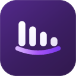
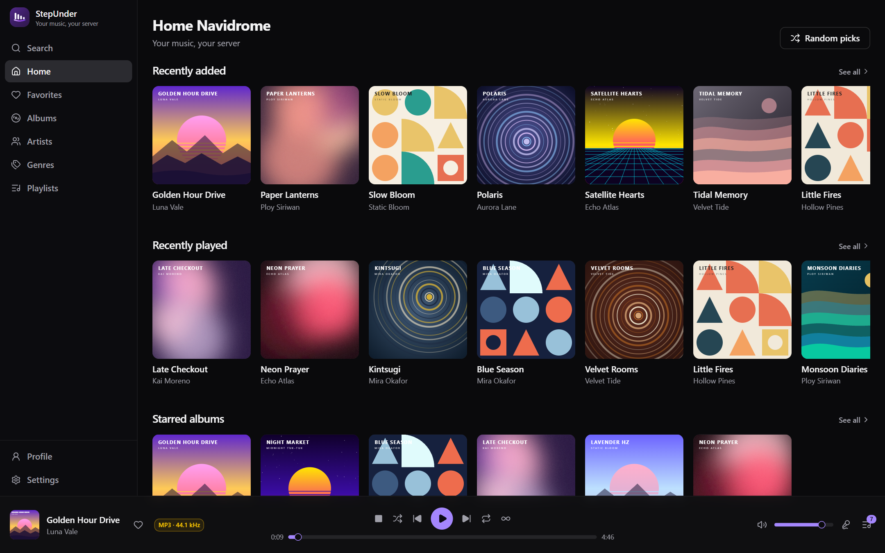
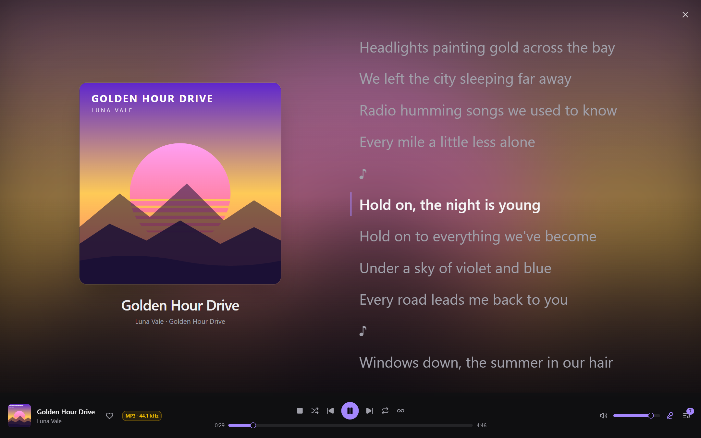
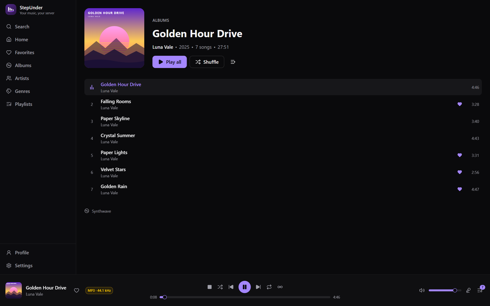
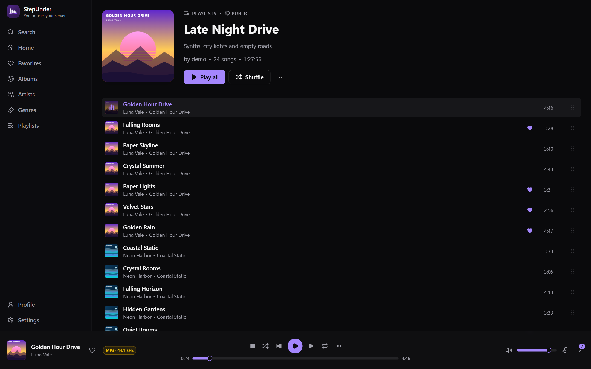
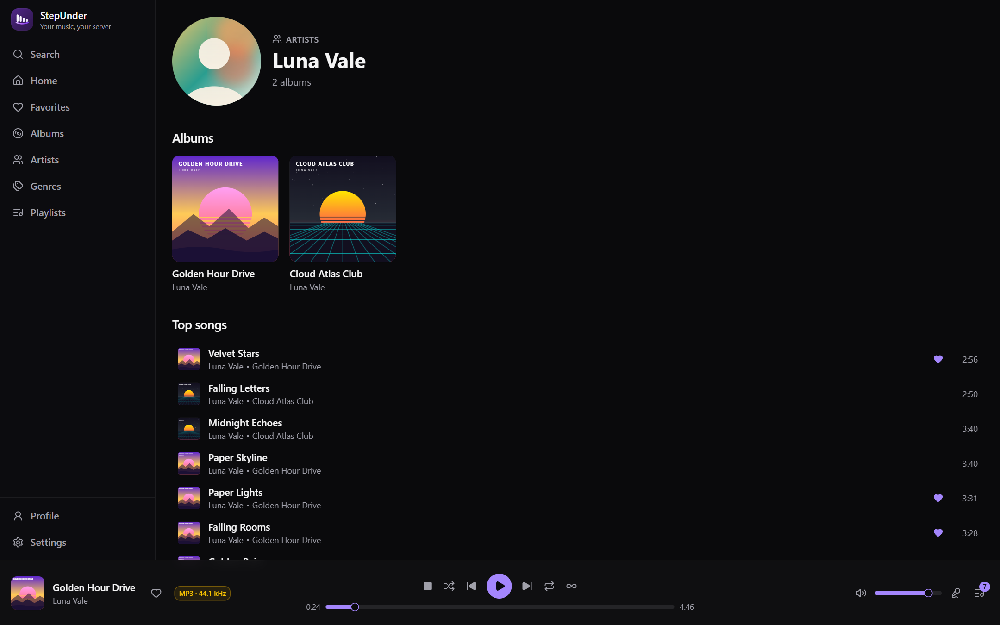
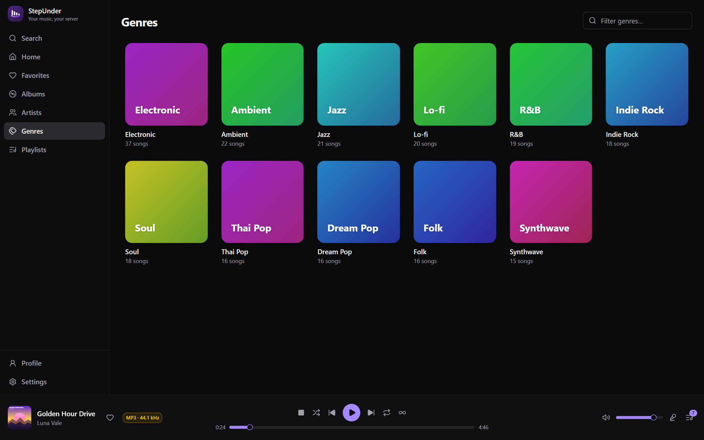
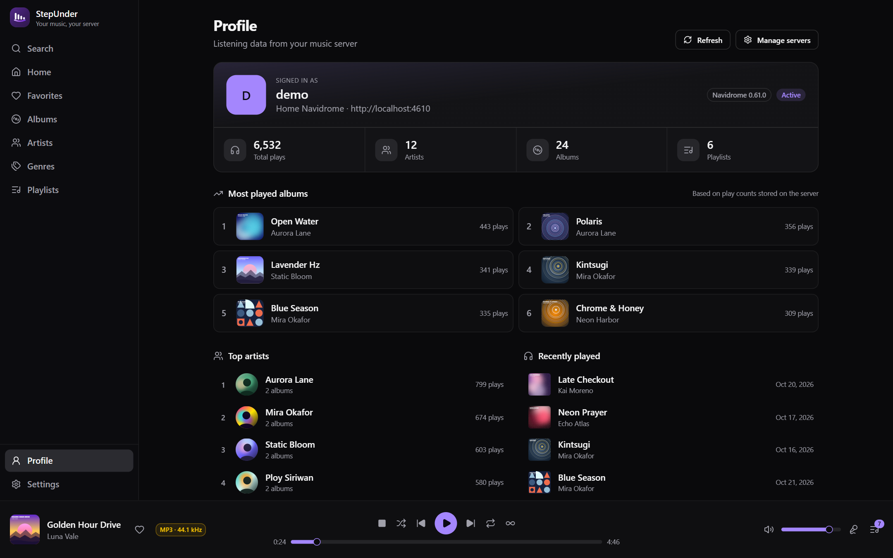

  

<h1 align="center">StepUnder</h1>

  <strong>Your music, your server.</strong> 
  A fast, private desktop player for Navidrome and Subsonic-compatible servers.

  
  
  

  <strong>English</strong> · <a href="README.th.md">ภาษาไทย</a>

  

StepUnder connects to the music server you already run and turns it into a
polished desktop listening experience — no cloud account, no telemetry, and no
uploads. Everything stays between you and your server.

> [!NOTE]
> StepUnder is in active development (v0.2.x). Features and UI may still change.

## Contents

- [Highlights](#highlights)
- [Screenshots](#screenshots)
- [Features](#features)
- [Keyboard shortcuts](#keyboard-shortcuts)
- [Installation](#installation)
- [License](#license)

## Highlights

|                            |                                                                                      |
| -------------------------- | ------------------------------------------------------------------------------------ |
| 🎵 **Your own server**     | Navidrome and any Subsonic / OpenSubsonic server — switch between several at will.  |
| 📻 **Track radio**         | Start an endless radio of similar songs from any track.                              |
| 📝 **Full playlist editor** | Create, edit, reorder with drag & drop, set custom covers, public or private.      |
| 🎚️ **Two audio engines**   | Built-in web player or the bundled **MPV** engine for wider format support.         |
| 🎨 **Make it yours**       | Dark / light / system theme, 7 accent colors, Thai or English UI.                   |
| 🔄 **Auto-updates**        | Signed in-app updates straight from GitHub Releases.                                 |
| 🔒 **Private by design**   | Passwords in the OS credential store. No backend, no analytics, no telemetry.        |

## Screenshots

  
   <b>Now Playing</b> — full-screen artwork with synced lyrics

<table>
  <tr>
    <td width="50%">
<b>Album</b>
</td>
    <td width="50%">
<b>Playlist</b> — drag to reorder
</td>
  </tr>
  <tr>
    <td width="50%">
<b>Artist</b>
</td>
    <td width="50%">
<b>Genres</b>
</td>
  </tr>
  <tr>
    <td colspan="2">
<b>Profile</b> — listening stats from your server
</td>
  </tr>
</table>

Screenshots use demo data with generated artwork.

## Features

### 📚 Library

- **Multiple servers** — save several servers and switch between them anytime.
- **Home** — newest albums, recently played, random picks, and your favorites.
- **Albums** — browse, sort, and keep scrolling to load more.
- **Artists** — artist pages with artwork, albums, and most-played songs.
- **Genres** — browse every genre, filter as you type, and shuffle a whole genre.
- **Favorites** — all your starred songs, albums, and artists in one place.
- **Search** — find songs, albums, and artists as you type.
- **Profile** — your listening stats from the server: total plays, top albums,
  top artists, most-played songs, and recent history.

### 🎶 Playlists

- **Create & edit** — name, description, and public / private visibility.
- **Custom covers** — upload a JPEG, PNG, WebP, or GIF cover
  (requires Navidrome 0.61+).
- **Add from anywhere** — right-click any song and choose *Add to playlist*,
  with a quick filter to find the right one.
- **Drag to reorder** — rearrange songs and remove the ones you don't want.
- **Delete** playlists you no longer need.

### ▶️ Playback

- **Queue** — play now, play next, add to queue, remove, or clear.
- **Controls** — shuffle, repeat (off / all / one), seek, volume, and mute.
- **Track radio** — build a queue of similar tracks from any song.
- **Resume where you left off** — queue, current track, and position are
  restored per server.
- **Now Playing** — a full-screen view with large artwork and a cover viewer.
- **Lyrics** — lyrics from your server, auto-scrolling when synced lyrics exist.
- **Song info** — title, album, genre, format, bit rate, sample rate, bit depth,
  channels, file size, play count, path, and more.
- **Two playback engines** — built-in web player, or MPV for broader format
  support.
- **Audio output** — choose which speaker or headphones to use.
- **Streaming quality** — original file, or transcode to MP3 / AAC / Opus / FLAC
  with an optional bitrate cap.
- **Scrobbling** — report plays to your server, or turn it off.
- **Discord Rich Presence** — optionally show what you're listening to.

### 🖥️ Desktop experience

- **Custom title bar** with a clean, native-feeling window.
- **Single instance** — launching again focuses the window that's already open.
- **Clean volume mixer** — appears as one *StepUnder* entry in the Windows
  volume mixer.
- **Automatic updates** — check on startup or manually, with release notes and
  download progress.

### 🎨 Personalization

- **Languages** — Thai and English, switchable at any time.
- **Themes** — dark, light, or follow the system.
- **Accent colors** — purple, blue, teal, green, orange, red, or pink.
- **Fonts** — system font or Sarabun for beautiful Thai text.

### 🔒 Privacy & security

- Passwords are saved in your operating system's credential store, never in a
  plain settings file.
- Your music and account stay on your server. StepUnder has no backend, no
  analytics, and no telemetry.

## Keyboard shortcuts

| Key                  | Action                       |
| -------------------- | ---------------------------- |
| `Space`              | Play / pause                 |
| `←` / `→`            | Seek backward / forward      |
| `↑` / `↓`            | Volume up / down             |
| `Shift` + `←` / `→`  | Previous / next track        |
| `Esc`                | Close the full-screen view   |

## Installation

1. Download the latest installer from the
   [**Releases page**](https://github.com/Steper158X/StepUnder/releases/latest).
2. Run the setup and launch **StepUnder**.
3. Enter your server URL, username, and password — and start listening.

After that, StepUnder keeps itself up to date automatically.

## License

Released under the [MIT License](LICENSE).
