<p align="center">
  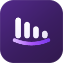
</p>

<h1 align="center">StepUnder</h1>

<p align="center">
  <strong>Sua música, seu servidor.</strong><br />
  Um player desktop rápido e privado para Navidrome e servidores compatíveis com Subsonic.
</p>

<p align="center">
  <a href="https://github.com/Steper158X/StepUnder/releases/latest"></a>
  
  <a href="LICENSE"></a>
</p>

<p align="center">
  <a href="README.md">English</a> · <a href="README.th.md">ภาษาไทย</a> · <a href="README.zh.md">简体中文</a> · <a href="README.es.md">Español</a> · <strong>Português</strong> · <a href="README.de.md">Deutsch</a> · <a href="README.fr.md">Français</a>
</p>

<p align="center">
  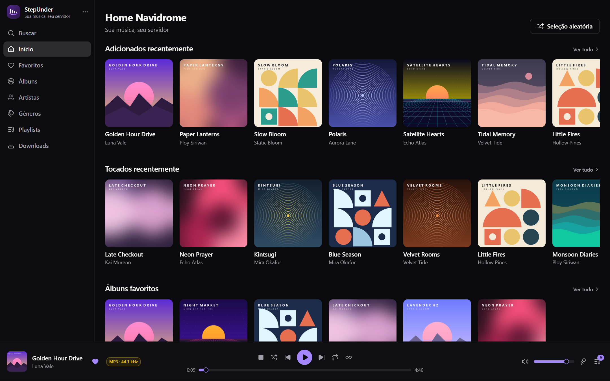
</p>

O StepUnder se conecta ao servidor de música que você já usa e o transforma em
uma experiência de audição refinada no desktop — sem conta na nuvem, sem
telemetria e sem uploads. Tudo fica entre você e o seu servidor.

> [!NOTE]
> O StepUnder está em desenvolvimento ativo (v0.3.x). Recursos e interface ainda podem mudar.

## Conteúdo

- [Destaques](#destaques)
- [Capturas de tela](#capturas-de-tela)
- [Recursos](#recursos)
- [Atalhos de teclado](#atalhos-de-teclado)
- [Instalação](#instalação)
- [Licença](#licença)

## Destaques

|                                 |                                                                                     |
| ------------------------------- | ----------------------------------------------------------------------------------- |
| 🎵 **Seu próprio servidor**     | Navidrome e qualquer servidor Subsonic / OpenSubsonic — alterne entre vários quando quiser. |
| ⬇️ **Downloads**                | Salve músicas, álbuns e playlists no computador e ouça offline.                    |
| 📻 **Rádio da faixa**           | Comece uma rádio infinita de músicas parecidas a partir de qualquer faixa.        |
| 📝 **Editor de playlists completo** | Crie, edite, reordene arrastando, defina capas próprias, pública ou privada.   |
| 🎚️ **Dois motores de áudio**    | Player web integrado ou o motor **MPV** incluso para mais formatos.               |
| 🎨 **Do seu jeito**             | Tema escuro / claro / do sistema, 7 cores de destaque, interface em 7 idiomas.    |
| 🔄 **Atualizações automáticas** | Atualizações assinadas dentro do app, direto do GitHub Releases.                   |
| 🔒 **Privado por padrão**       | Senhas no cofre de credenciais do sistema. Sem backend, sem análises, sem telemetria. |

## Capturas de tela

<p align="center">
  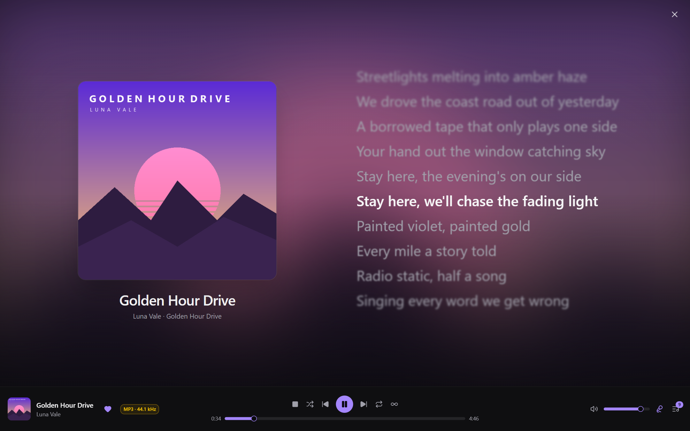
  <br /><sub><b>Tocando agora</b> — capa em tela cheia com letra sincronizada</sub>
</p>

<table>
  <tr>
    <td width="50%">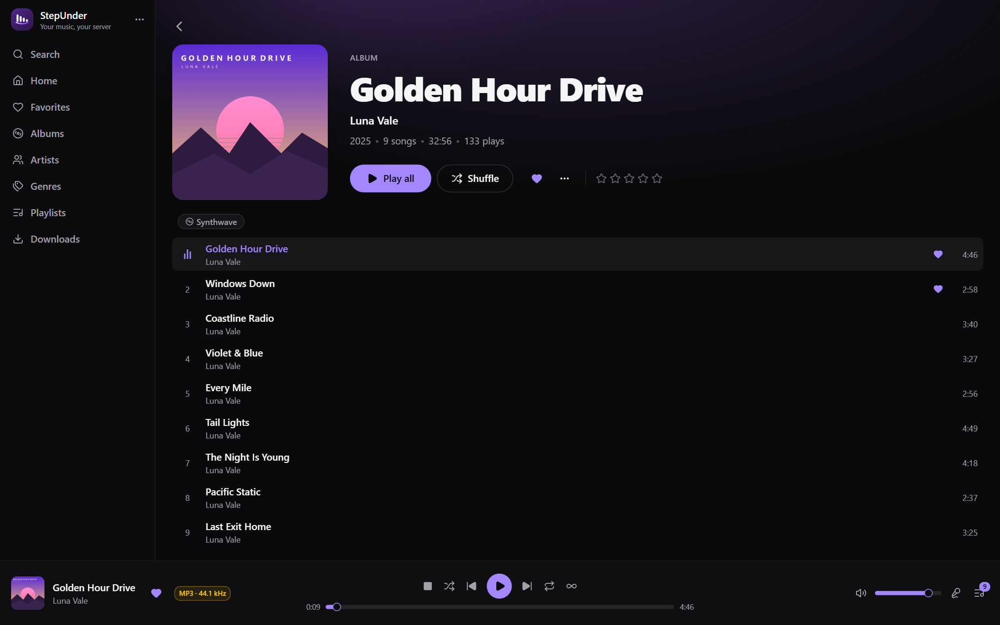<p align="center"><sub><b>Álbum</b></sub></p></td>
    <td width="50%">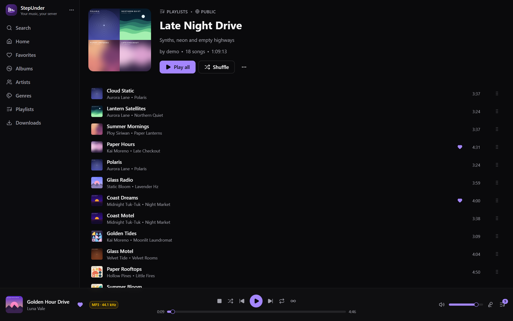<p align="center"><sub><b>Playlist</b> — arraste para reordenar</sub></p></td>
  </tr>
  <tr>
    <td width="50%">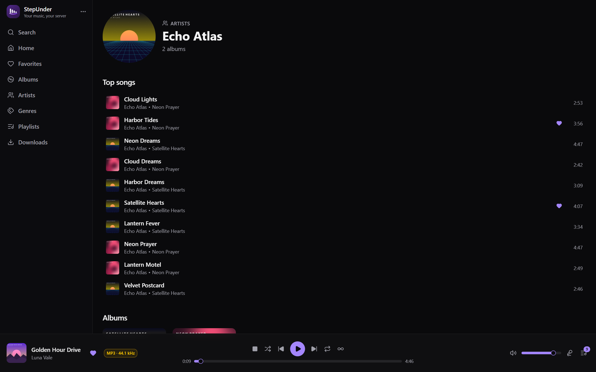<p align="center"><sub><b>Artista</b></sub></p></td>
    <td width="50%">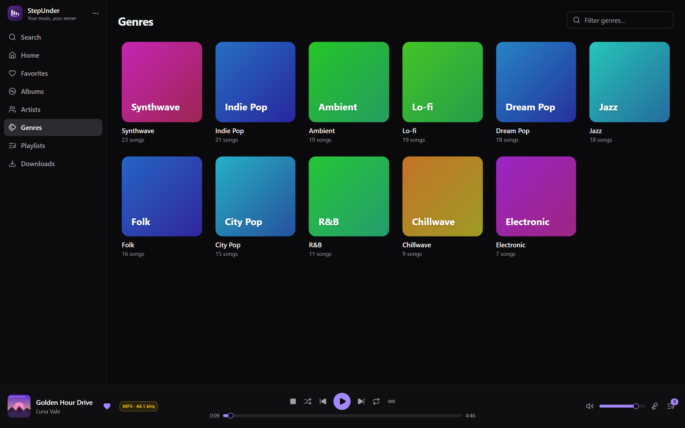<p align="center"><sub><b>Gêneros</b></sub></p></td>
  </tr>
  <tr>
    <td colspan="2">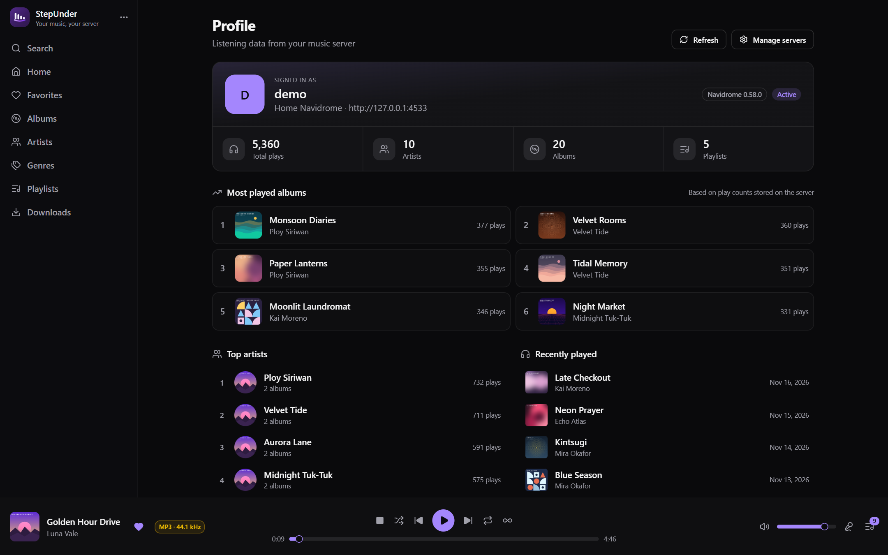<p align="center"><sub><b>Perfil</b> — estatísticas de audição do seu servidor</sub></p></td>
  </tr>
</table>

<table>
  <tr>
    <td width="33%">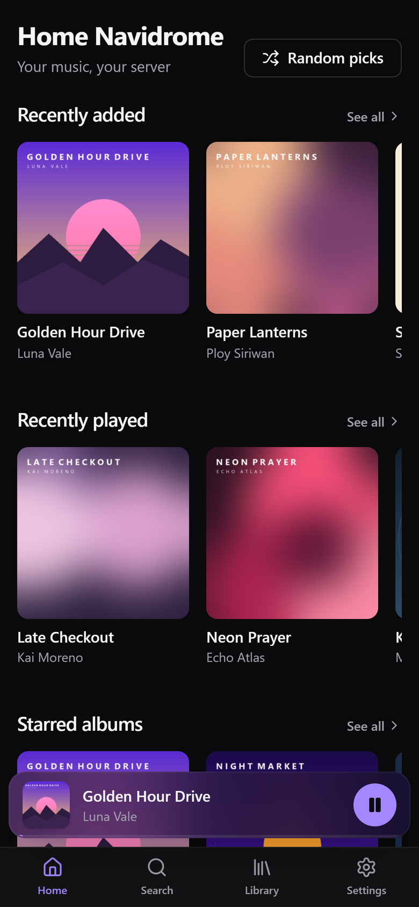</td>
    <td width="33%">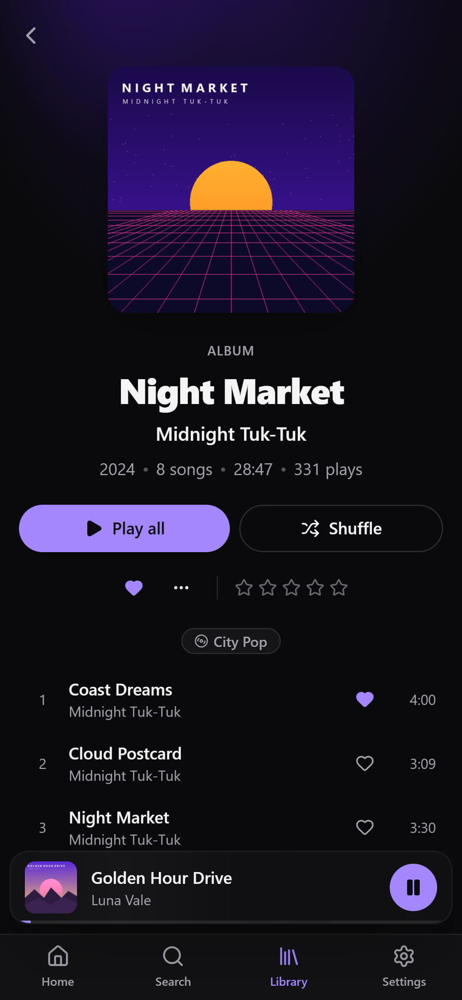</td>
    <td width="33%">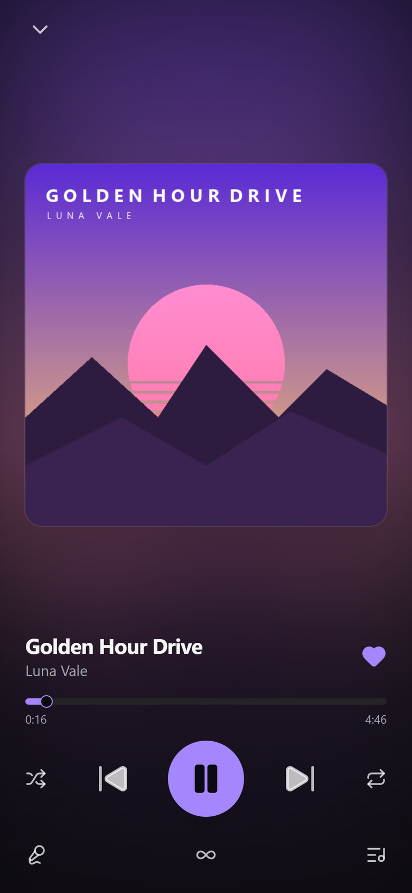</td>
  </tr>
  <tr>
    <td colspan="3"><p align="center"><sub><b>Android</b> — a mesma biblioteca, feita para o seu celular</sub></p></td>
  </tr>
</table>

<sub>As capturas usam dados de demonstração com capas geradas.</sub>

## Recursos

### 📚 Biblioteca

- **Vários servidores** — salve vários servidores e alterne entre eles a qualquer momento.
- **Início** — álbuns mais novos, tocados recentemente, escolhas aleatórias e seus favoritos.
- **Álbuns** — navegue, ordene e continue rolando para carregar mais. As páginas
  de álbum brilham com uma cor tirada da capa, mostram o número de reproduções e
  separam álbuns com vários discos.
- **Avaliações e favoritos** — avalie músicas e álbuns de 1 a 5 estrelas e
  favorite álbuns pelo menu do botão direito, ou avalie um álbum na própria página.
- **Artistas** — páginas de artista com imagem, álbuns e músicas mais tocadas.
- **Gêneros** — veja todos os gêneros, filtre enquanto digita e toque um gênero inteiro em ordem aleatória.
- **Favoritos** — todas as músicas, álbuns e artistas favoritos em um só lugar.
- **Busca** — encontre músicas, álbuns e artistas enquanto digita.
- **Perfil** — suas estatísticas de audição no servidor: total de reproduções,
  álbuns e artistas favoritos, músicas mais tocadas e histórico recente.
- **Compartilhar** — clique com o botão direito em uma música para criar um link
  público, com validade, descrição e permissão de download opcionais
  (requer compartilhamento ativado no Navidrome com `ND_ENABLESHARING=true`).

### ⬇️ Downloads

- **Baixe o que quiser** — clique com o botão direito em uma música, ou baixe um álbum ou playlist inteiros de uma vez.
- **Ouça offline** — músicas baixadas tocam a partir do arquivo no computador em vez de streaming.
- **Página de downloads** — tudo o que está salvo neste computador e o que ainda
  está baixando, com tentar de novo, cancelar e remover.
- **Baixar favoritos** — opcionalmente, baixe uma música assim que favoritá-la.
- **Você escolhe o arquivo** — mantenha o arquivo original ou deixe o servidor
  convertê-lo para um formato e bitrate menores.
- **Pasta e armazenamento** — escolha a pasta de downloads e sua organização, e
  veja quanto espaço os downloads ocupam e quanto resta no disco.

### 🎶 Playlists

- **Criar e editar** — nome, descrição e visibilidade pública / privada.
- **Capas próprias** — envie uma capa JPEG, PNG, WebP ou GIF (requer Navidrome 0.61+).
- **Adicione de qualquer lugar** — clique com o botão direito em qualquer música e
  escolha *Adicionar à playlist*, com um filtro rápido para achar a certa.
- **Arraste para reordenar** — reorganize músicas e remova as que não quiser.
- **Exclua** playlists que você não precisa mais.

### ▶️ Reprodução

- **Fila** — tocar agora, tocar em seguida, adicionar à fila, remover ou limpar.
- **Controles** — aleatório, repetir (desligado / todas / uma), avançar, volume e mudo.
- **Rádio da faixa** — monte uma fila de faixas parecidas a partir de qualquer música.
- **Continue de onde parou** — fila, faixa atual e posição são restauradas por servidor.
- **Tocando agora** — visualização em tela cheia com capa grande e visualizador de capas.
- **Letras** — letras do seu servidor, com rolagem automática quando sincronizadas.
  Opcionalmente desfoque as linhas ao redor da que está sendo cantada, mostre
  leituras fonéticas para japonês, coreano e chinês, ou mantenha a letra ao lado da fila.
- **Informações da música** — título, álbum, gênero, formato, bitrate, taxa de
  amostragem, profundidade de bits, canais, tamanho, reproduções, caminho e mais.
- **Dois motores de reprodução** — player web integrado ou MPV para mais formatos.
- **Saída de áudio** — escolha qual alto-falante ou fone usar.
- **Qualidade de streaming** — arquivo original ou transcodificação para MP3 / AAC / Opus / FLAC
  com limite de bitrate opcional.
- **Scrobbling** — informe as reproduções ao seu servidor, ou desative.
- **Discord Rich Presence** — mostre opcionalmente o que você está ouvindo.

### 🖥️ Experiência desktop

- **Barra de título personalizada** com uma janela limpa e com cara de nativa.
- **Instância única** — abrir de novo traz para a frente a janela já aberta.
- **Mixer de volume limpo** — aparece como uma única entrada *StepUnder* no mixer de volume do Windows.
- **Atualizações automáticas** — verifique ao iniciar ou manualmente, com notas da versão e progresso do download.
- **Cache de capas** — as capas ficam salvas no disco e carregam instantaneamente,
  mesmo depois de reiniciar. Defina o tamanho máximo e a frequência de atualização,
  ou limpe o cache em **Configurações → Cache**.
- **Leve na memória** — as páginas carregam só quando você as abre, listas longas e
  a fila desenham apenas as linhas visíveis, e no Windows o app libera memória
  enquanto fica em segundo plano.

### 🎨 Personalização

- **Idiomas** — inglês, tailandês, chinês simplificado, espanhol, português, alemão e francês, alternáveis a qualquer momento.
- **Temas** — escuro, claro ou seguir o sistema.
- **Liquid Glass** — painéis de vidro translúcido com desfoque ajustável; no
  Windows a própria janela pode ser transparente (Acrylic ou Mica).
- **Layout do player** — barra fixa embaixo ou flutuando sobre o conteúdo.
- **Cores de destaque** — roxo, azul, verde-azulado, verde, laranja, vermelho ou rosa.
- **Fontes** — fonte do sistema ou Sarabun para um texto tailandês bonito.

### 🔒 Privacidade e segurança

- As senhas ficam no cofre de credenciais do sistema operacional, nunca em um arquivo de configurações em texto puro.
- Sua música e sua conta ficam no seu servidor. O StepUnder não tem backend, análises nem telemetria.

## Atalhos de teclado

| Tecla                | Ação                               |
| -------------------- | ---------------------------------- |
| `Space`              | Tocar / pausar                     |
| `←` / `→`            | Voltar / avançar                   |
| `↑` / `↓`            | Aumentar / diminuir volume         |
| `Shift` + `←` / `→`  | Faixa anterior / próxima           |
| `Esc`                | Fechar a visualização em tela cheia |

## Instalação

1. Baixe o instalador mais recente na
   [**página de Releases**](https://github.com/Steper158X/StepUnder/releases/latest).
2. Execute o instalador e abra o **StepUnder**.
3. Informe a URL do servidor, usuário e senha — e comece a ouvir.

Depois disso, o StepUnder se mantém atualizado automaticamente.

### Android

Baixe `StepUnder_<version>_android.apk` na
[**página de Releases**](https://github.com/Steper158X/StepUnder/releases/latest)
e abra no celular para instalar (permita instalações pelo navegador ou gerenciador
de arquivos se o Android pedir). O app Android tem layout para celular, continua
tocando em segundo plano com controles na notificação e permite escolher a saída
de áudio (alto-falante, Bluetooth, com fio ou USB). O app procura novas versões no
GitHub ao iniciar (ou em **Configurações → Sobre**) e abre o APK mais novo para você
instalar por cima do antigo.

### Linux (Ubuntu, Pop!_OS)

As versões são feitas para Ubuntu 22.04 / Pop!_OS 22.04 ou mais recentes (x86_64).

- **.deb** (recomendado): baixe `StepUnder_<version>_amd64.deb` e depois

  ```bash
  sudo apt install ./StepUnder_*_amd64.deb
  ```

- **AppImage**: baixe `StepUnder_<version>_amd64.AppImage`, torne-o executável
  (`chmod +x StepUnder_*.AppImage`) e execute. O AppImage se atualiza sozinho em
  **Configurações → Atualizações**.

O player MPV funciona de imediato: o `.deb` instala a libmpv como dependência e o
AppImage traz sua própria cópia. As senhas salvas vão para o GNOME Keyring. Os
efeitos de janela Mica/Acrylic são exclusivos do Windows. Com o driver proprietário
da NVIDIA, o StepUnder define `WEBKIT_DISABLE_DMABUF_RENDERER=1` para você. Se a
janela ainda abrir em branco, inicie com `WEBKIT_DISABLE_DMABUF_RENDERER=1` (ou
também `WEBKIT_DISABLE_COMPOSITING_MODE=1`).

### Compilando a partir do código no Linux

```bash
sudo apt install libwebkit2gtk-4.1-dev libgtk-3-dev libayatana-appindicator3-dev librsvg2-dev libssl-dev libdbus-1-dev pkg-config patchelf build-essential
```

Depois, `bun install` e `bun run tauri build` (ou `bun run tauri dev`).

## Licença

Distribuído sob a [Licença MIT](LICENSE).
