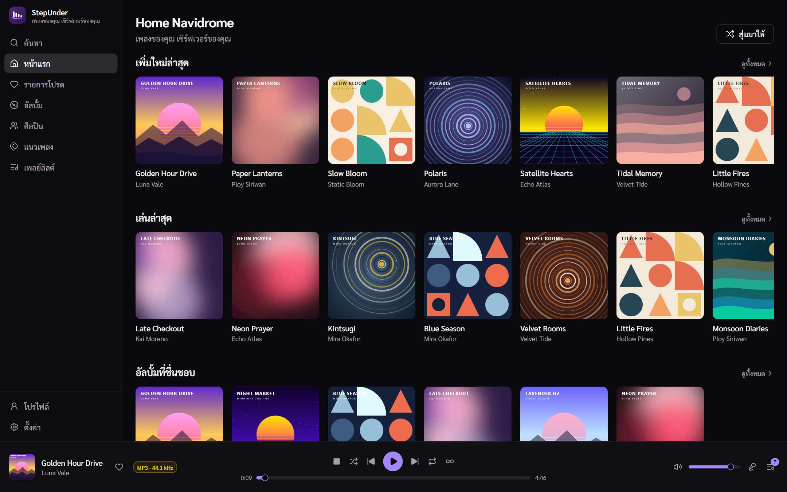
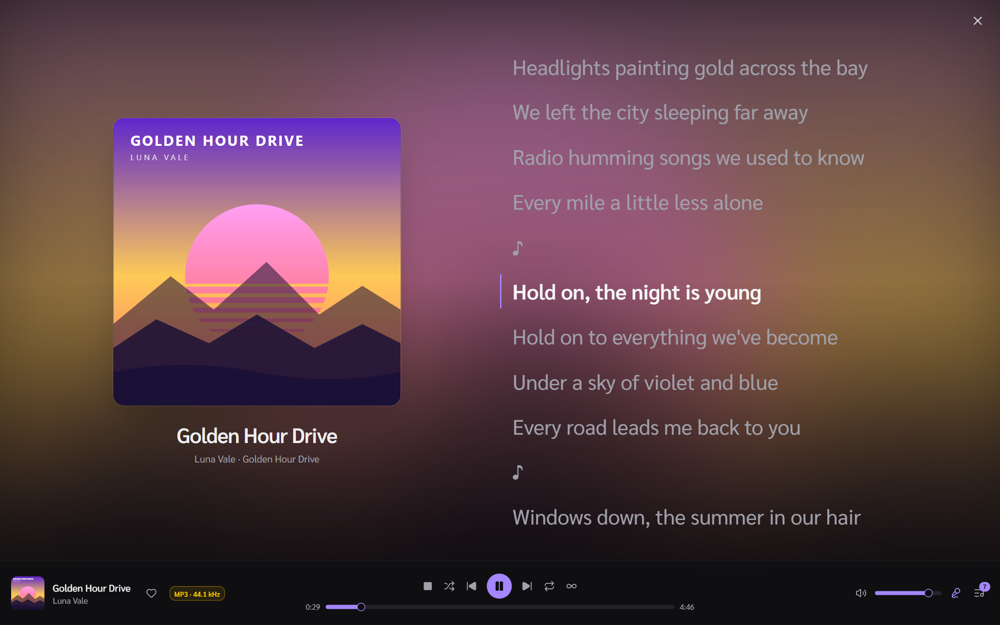

  

<h1 align="center">StepUnder</h1>

  <strong>เพลงของคุณ บนเซิร์ฟเวอร์ของคุณ</strong> 
  โปรแกรมเล่นเพลงบนเดสก์ท็อปที่รวดเร็วและเป็นส่วนตัว สำหรับ Navidrome และเซิร์ฟเวอร์ที่รองรับ Subsonic

  
  
  

  <a href="README.md">English</a> · <strong>ภาษาไทย</strong>

  

StepUnder เชื่อมต่อกับเซิร์ฟเวอร์เพลงที่คุณมีอยู่แล้ว และเปลี่ยนให้เป็นประสบการณ์
ฟังเพลงบนเดสก์ท็อปที่ลื่นไหลและสวยงาม — ไม่ต้องมีบัญชีคลาวด์ ไม่มี telemetry
และไม่อัปโหลดข้อมูลใด ๆ ทุกอย่างอยู่ระหว่างคุณกับเซิร์ฟเวอร์ของคุณเท่านั้น

> [!NOTE]
> StepUnder อยู่ระหว่างการพัฒนา (v0.2.x) ฟีเจอร์และหน้าตาอาจมีการเปลี่ยนแปลง

## สารบัญ

- [จุดเด่น](#จุดเด่น)
- [ภาพตัวอย่าง](#ภาพตัวอย่าง)
- [ฟีเจอร์](#ฟีเจอร์)
- [คีย์ลัด](#คีย์ลัด)
- [การติดตั้ง](#การติดตั้ง)
- [สัญญาอนุญาต](#สัญญาอนุญาต)

## จุดเด่น

|                                  |                                                                                  |
| -------------------------------- | -------------------------------------------------------------------------------- |
| 🎵 **ใช้เซิร์ฟเวอร์ของคุณเอง**      | Navidrome และเซิร์ฟเวอร์ Subsonic / OpenSubsonic — บันทึกได้หลายเครื่องและสลับได้ทันที |
| ⬇️ **ดาวน์โหลด**                  | บันทึกเพลง อัลบั้ม และเพลย์ลิสต์ไว้ในเครื่อง แล้วฟังได้แม้ไม่มีเน็ต                      |
| 📻 **Track radio**               | เริ่มวิทยุเพลงที่คล้ายกันแบบต่อเนื่องจากเพลงไหนก็ได้                                  |
| 📝 **จัดการเพลย์ลิสต์ครบ**         | สร้าง แก้ไข ลากเรียงลำดับ ตั้งปกเอง และกำหนดสาธารณะ/ส่วนตัว                         |
| 🎚️ **สองเอนจินเสียง**             | เครื่องเล่นในตัว หรือเอนจิน **MPV** ที่รองรับฟอร์แมตได้กว้างขึ้น                        |
| 🎨 **ปรับแต่งได้ตามใจ**            | ธีมมืด / สว่าง / ตามระบบ, สีหลัก 7 สี, UI ภาษาไทยหรืออังกฤษ                          |
| 🔄 **อัปเดตอัตโนมัติ**             | อัปเดตในแอปแบบมีลายเซ็นดิจิทัล ตรงจาก GitHub Releases                              |
| 🔒 **เป็นส่วนตัวตั้งแต่การออกแบบ**   | เก็บรหัสผ่านใน credential store ของระบบ ไม่มี backend ไม่มี analytics ไม่มี telemetry |

## ภาพตัวอย่าง

  
   <b>Now Playing</b> — ปกอัลบั้มเต็มจอพร้อมเนื้อเพลงที่เลื่อนตามจังหวะ

<table>
  <tr>
    <td width="50%">
<b>อัลบั้ม</b>
</td>
    <td width="50%">
<b>เพลย์ลิสต์</b> — ลากเพื่อเรียงลำดับ
</td>
  </tr>
  <tr>
    <td width="50%">
<b>ศิลปิน</b>
</td>
    <td width="50%">
<b>แนวเพลง</b>
</td>
  </tr>
  <tr>
    <td colspan="2">
<b>โปรไฟล์</b> — สถิติการฟังจากเซิร์ฟเวอร์ของคุณ
</td>
  </tr>
</table>

ภาพตัวอย่างใช้ข้อมูลจำลองและภาพปกที่สร้างขึ้นเพื่อการสาธิต

## ฟีเจอร์

### 📚 คลังเพลง

- **หลายเซิร์ฟเวอร์** — บันทึกได้หลายเครื่องและสลับไปมาได้ทุกเมื่อ
- **หน้าแรก** — อัลบั้มใหม่ เพิ่งเล่นล่าสุด สุ่มเพลง และรายการโปรด
- **อัลบั้ม** — เรียกดู เรียงลำดับ และเลื่อนเพื่อโหลดเพิ่มได้เรื่อย ๆ
- **ศิลปิน** — หน้าศิลปินพร้อมรูปภาพ อัลบั้ม และเพลงที่เล่นบ่อยที่สุด
- **แนวเพลง** — ดูแนวเพลงทั้งหมด กรองขณะพิมพ์ และสุ่มเล่นทั้งแนวเพลงได้
- **รายการโปรด** — รวมเพลง อัลบั้ม และศิลปินที่กดถูกใจไว้ในที่เดียว
- **ค้นหา** — ค้นหาเพลง อัลบั้ม และศิลปินได้ขณะพิมพ์
- **โปรไฟล์** — สถิติการฟังจากเซิร์ฟเวอร์ ทั้งจำนวนครั้งที่เล่น อัลบั้มที่เล่นบ่อย
  ศิลปินยอดนิยม เพลงที่เล่นบ่อย และประวัติการฟังล่าสุด
- **แชร์** — คลิกขวาที่เพลงเพื่อสร้างลิงก์สาธารณะ ตั้งวันหมดอายุ คำอธิบาย
  และสิทธิ์ดาวน์โหลดได้
  (ต้องเปิดการแชร์ใน Navidrome ด้วย `ND_ENABLESHARING=true`)

### ⬇️ ดาวน์โหลด

- **ดาวน์โหลดได้ทุกอย่าง** — คลิกขวาที่เพลง หรือดาวน์โหลดทั้งอัลบั้มหรือเพลย์ลิสต์ในครั้งเดียว
- **ฟังแบบออฟไลน์** — เพลงที่ดาวน์โหลดไว้จะเล่นจากไฟล์ในเครื่องแทนการสตรีม
- **หน้าดาวน์โหลด** — รวมเพลงที่บันทึกไว้ในเครื่องและเพลงที่กำลังดาวน์โหลด
  พร้อมปุ่มลองใหม่ ยกเลิก และลบ
- **ดาวน์โหลดเพลงที่ชื่นชอบ** — เลือกให้ดาวน์โหลดเพลงอัตโนมัติเมื่อกดถูกใจ
- **เลือกไฟล์ได้** — เก็บไฟล์ต้นฉบับ หรือให้เซิร์ฟเวอร์แปลงเป็นรูปแบบและบิตเรตที่เล็กลง
- **โฟลเดอร์และพื้นที่** — เลือกโฟลเดอร์ดาวน์โหลดและการจัดโฟลเดอร์
  ดูพื้นที่ที่ใช้ไปและพื้นที่ว่างในไดรฟ์

### 🎶 เพลย์ลิสต์

- **สร้างและแก้ไข** — ตั้งชื่อ คำอธิบาย และเลือกเป็นสาธารณะหรือส่วนตัว
- **ตั้งปกเอง** — อัปโหลดรูป JPEG, PNG, WebP หรือ GIF (ต้องใช้ Navidrome 0.61 ขึ้นไป)
- **เพิ่มเพลงได้จากทุกที่** — คลิกขวาที่เพลงใดก็ได้แล้วเลือก *เพิ่มลงเพลย์ลิสต์*
  พร้อมช่องค้นหาเพลย์ลิสต์อย่างรวดเร็ว
- **ลากเพื่อเรียงลำดับ** — จัดลำดับเพลงใหม่ และลบเพลงที่ไม่ต้องการออก
- **ลบเพลย์ลิสต์** ที่ไม่ใช้แล้วได้

### ▶️ การเล่นเพลง

- **คิวเพลง** — เล่นทันที เล่นถัดไป เพิ่มเข้าคิว ลบเพลง หรือล้างคิว
- **ปุ่มควบคุม** — shuffle, repeat (ปิด / ทั้งหมด / เพลงเดียว), เลื่อนตำแหน่ง, ปรับเสียง และ mute
- **Track radio** — สร้างคิวเพลงที่คล้ายกันจากเพลงไหนก็ได้
- **เล่นต่อจากเดิม** — คิว เพลงปัจจุบัน และตำแหน่งที่เล่น ถูกกู้คืนแยกตามเซิร์ฟเวอร์
- **หน้า Now Playing** — แสดงผลเต็มจอพร้อมปกอัลบั้มขนาดใหญ่ และดูปกแบบขยายได้
- **เนื้อเพลง** — แสดงเนื้อเพลงจากเซิร์ฟเวอร์ และเลื่อนตามจังหวะอัตโนมัติเมื่อมีเนื้อเพลงแบบ synced
  เลือกเบลอบรรทัดรอบ ๆ บรรทัดที่กำลังร้อง แสดงคำอ่านภาษาญี่ปุ่น เกาหลี และจีน
  หรือแสดงเนื้อเพลงไว้ข้างคิวได้
- **ข้อมูลเพลง** — ชื่อเพลง อัลบั้ม แนวเพลง ฟอร์แมต bit rate, sample rate, bit depth,
  จำนวนช่องเสียง ขนาดไฟล์ จำนวนครั้งที่เล่น ที่อยู่ไฟล์ และอื่น ๆ
- **สองเอนจินเสียง** — เครื่องเล่นในตัว หรือ MPV เพื่อรองรับฟอร์แมตได้มากขึ้น
- **อุปกรณ์เสียงออก** — เลือกลำโพงหรือหูฟังที่ต้องการใช้
- **คุณภาพการสตรีม** — เล่นไฟล์ต้นฉบับ หรือแปลงเป็น MP3 / AAC / Opus / FLAC พร้อมจำกัด bitrate
- **Scrobbling** — ส่งประวัติการเล่นกลับไปยังเซิร์ฟเวอร์ หรือปิดก็ได้
- **Discord Rich Presence** — แสดงเพลงที่กำลังฟังบน Discord (เปิดใช้ได้ตามต้องการ)

### 🖥️ ประสบการณ์บนเดสก์ท็อป

- **Title bar แบบกำหนดเอง** หน้าต่างดูสะอาดตาและเป็นธรรมชาติ
- **เปิดได้หน้าต่างเดียว** — ถ้าเปิดแอปซ้ำ จะสลับไปยังหน้าต่างที่เปิดอยู่แล้ว
- **Volume mixer เรียบร้อย** — แสดงเป็นรายการ *StepUnder* รายการเดียวใน volume mixer ของ Windows
- **อัปเดตอัตโนมัติ** — ตรวจสอบตอนเปิดแอปหรือกดตรวจเอง พร้อมแสดงรายละเอียดเวอร์ชันและความคืบหน้าการดาวน์โหลด

### 🎨 การปรับแต่ง

- **ภาษา** — ไทยและอังกฤษ สลับได้ทุกเมื่อ
- **ธีม** — มืด สว่าง หรือตามระบบ
- **Liquid Glass** — แผงโปร่งแสงแบบกระจก ปรับความเบลอได้ บน Windows
  ทำให้ทั้งหน้าต่างโปร่งทะลุได้ (Acrylic หรือ Mica)
- **รูปแบบแถบเล่นเพลง** — ติดขอบล่าง หรือให้ลอยอยู่เหนือเนื้อหา
- **สีหลัก** — ม่วง น้ำเงิน เขียวอมฟ้า เขียว ส้ม แดง หรือชมพู
- **ฟอนต์** — ฟอนต์ของระบบ หรือฟอนต์ Sarabun เพื่อข้อความภาษาไทยที่สวยงาม

### 🔒 ความเป็นส่วนตัวและความปลอดภัย

- รหัสผ่านถูกเก็บใน credential store ของระบบปฏิบัติการ ไม่ได้เก็บในไฟล์ตั้งค่าแบบข้อความธรรมดา
- เพลงและบัญชีของคุณอยู่บนเซิร์ฟเวอร์ของคุณ StepUnder ไม่มี backend ไม่มี analytics และไม่มี telemetry

## คีย์ลัด

| ปุ่ม                  | การทำงาน                |
| -------------------- | ---------------------- |
| `Space`              | เล่น / หยุดชั่วคราว       |
| `←` / `→`            | เลื่อนถอยหลัง / ไปข้างหน้า |
| `↑` / `↓`            | เพิ่ม / ลดเสียง           |
| `Shift` + `←` / `→`  | เพลงก่อนหน้า / เพลงถัดไป  |
| `Esc`                | ปิดหน้าจอเต็ม            |

## การติดตั้ง

1. ดาวน์โหลดตัวติดตั้งล่าสุดจาก
   [**หน้า Releases**](https://github.com/Steper158X/StepUnder/releases/latest)
2. รันตัวติดตั้งแล้วเปิด **StepUnder**
3. กรอก URL ของเซิร์ฟเวอร์ ชื่อผู้ใช้ และรหัสผ่าน — แล้วเริ่มฟังเพลงได้เลย

หลังจากนั้น StepUnder จะอัปเดตตัวเองให้อัตโนมัติ

## สัญญาอนุญาต

เผยแพร่ภายใต้ [MIT License](LICENSE)
