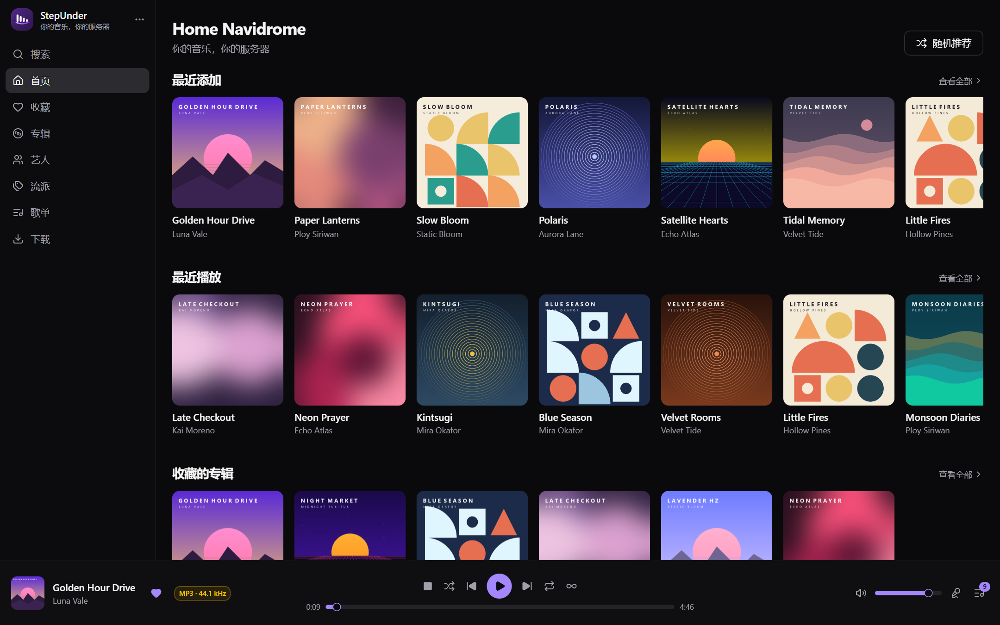
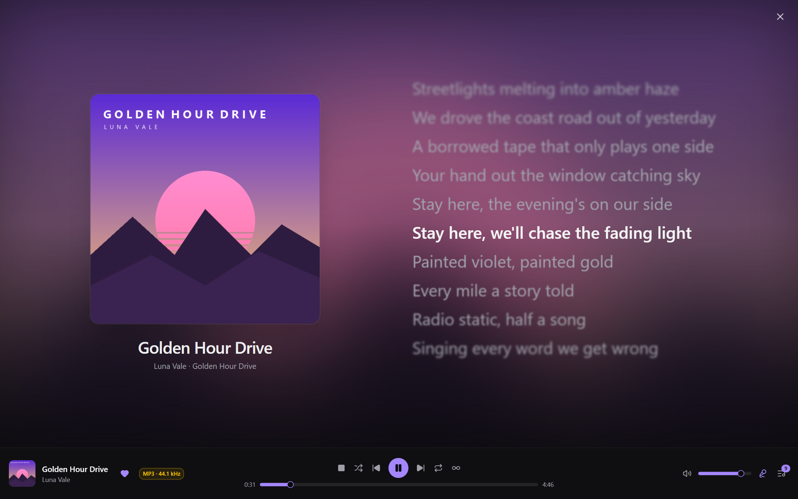
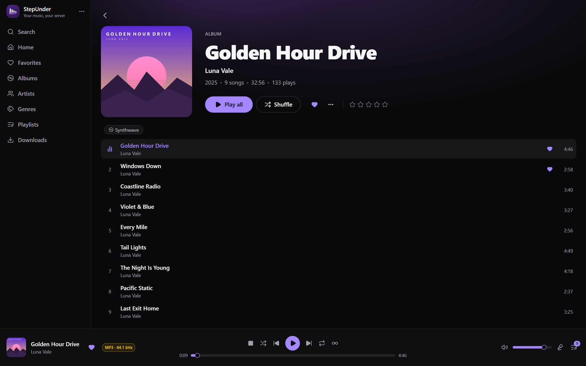
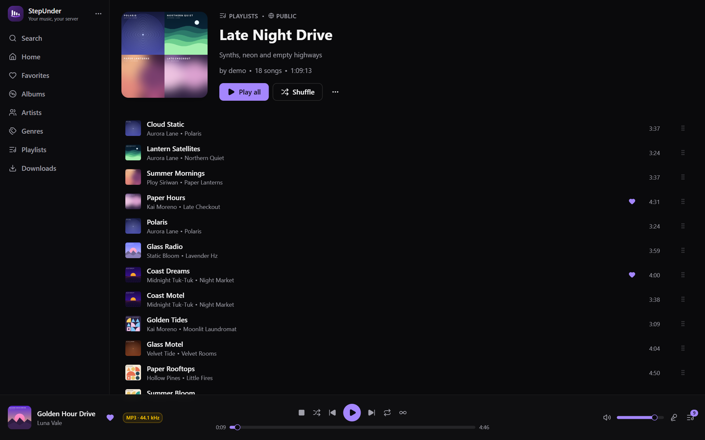
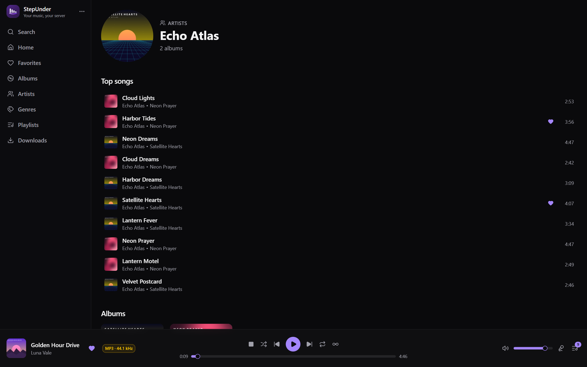
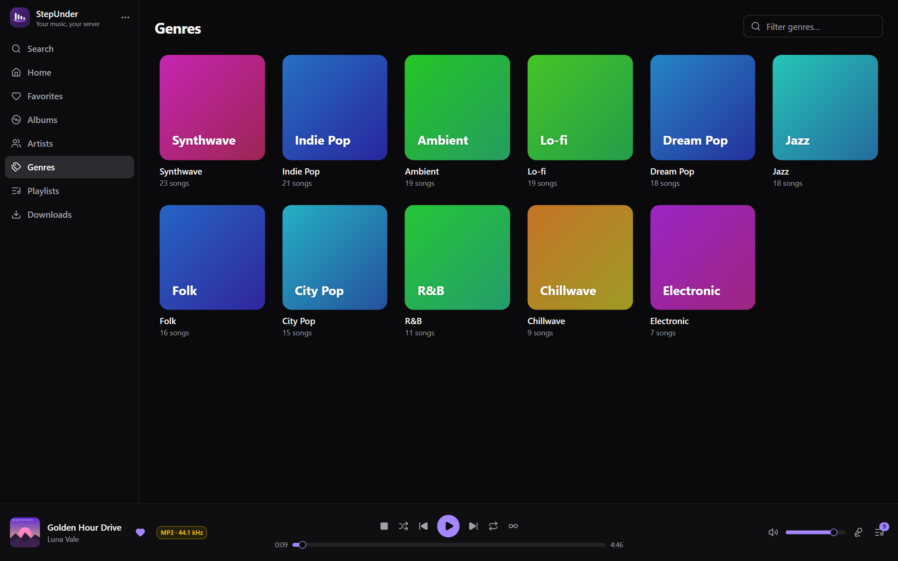
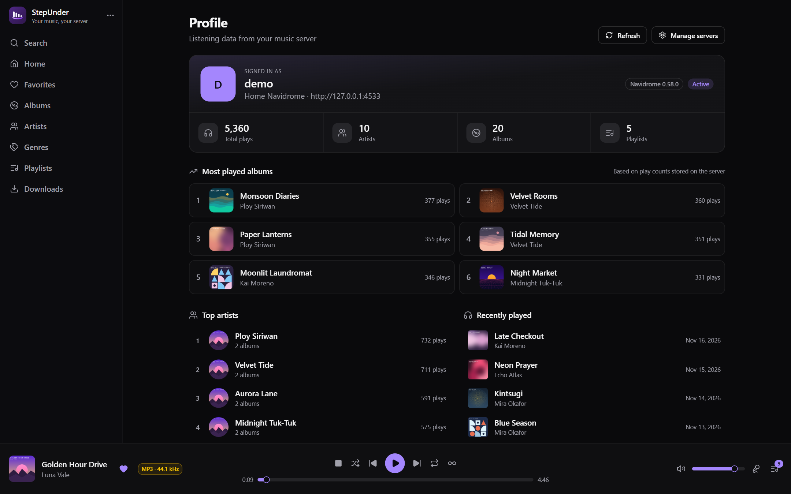
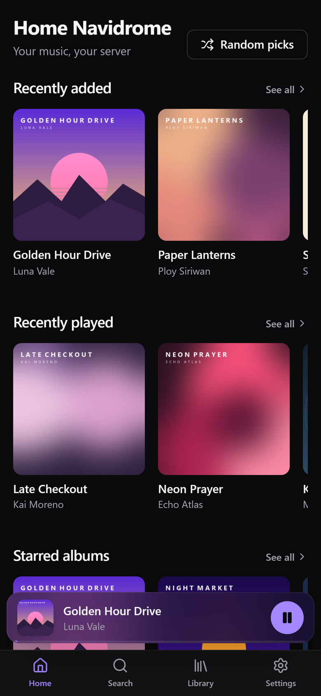
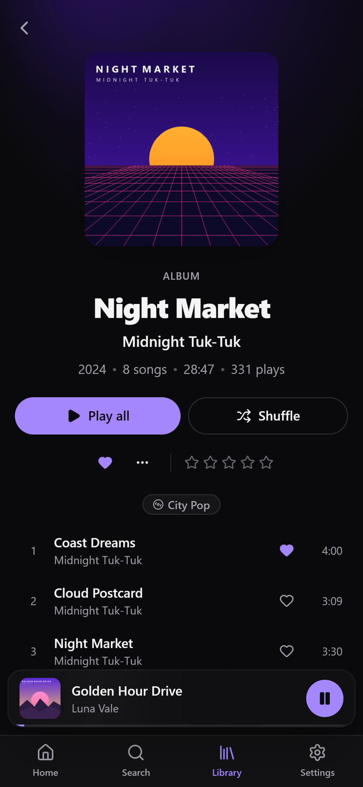

<p align="center">
  
</p>

<h1 align="center">StepUnder</h1>

<p align="center">
  <strong>你的音乐，你的服务器。</strong><br />
  一款快速、私密的桌面播放器，适用于 Navidrome 及兼容 Subsonic 的服务器。
</p>

<p align="center">
  <a href="https://github.com/Steper158X/StepUnder/releases/latest"></a>
  
  <a href="LICENSE"></a>
</p>

<p align="center">
  <a href="README.md">English</a> · <a href="README.th.md">ภาษาไทย</a> · <strong>简体中文</strong> · <a href="README.es.md">Español</a> · <a href="README.pt.md">Português</a> · <a href="README.de.md">Deutsch</a> · <a href="README.fr.md">Français</a>
</p>

<p align="center">
  
</p>

StepUnder 连接你已经在运行的音乐服务器，把它变成精致的桌面听歌体验——无需云账号、
没有遥测、不上传任何内容。一切只在你和你的服务器之间。

> [!NOTE]
> StepUnder 正在积极开发中（v0.2.x），功能和界面仍可能变化。

## 目录

- [亮点](#亮点)
- [截图](#截图)
- [功能](#功能)
- [键盘快捷键](#键盘快捷键)
- [安装](#安装)
- [许可证](#许可证)

## 亮点

|                         |                                                                     |
| ----------------------- | ------------------------------------------------------------------- |
| 🎵 **自己的服务器**     | 支持 Navidrome 和任何 Subsonic / OpenSubsonic 服务器，可随时切换多个服务器。 |
| ⬇️ **下载**             | 将歌曲、专辑和播放列表保存到电脑，离线播放。                         |
| 📻 **单曲电台**         | 从任意歌曲开始，无限播放相似歌曲。                                   |
| 📝 **完整的播放列表编辑** | 创建、编辑、拖放排序、自定义封面、公开或私密。                     |
| 🎚️ **两种音频引擎**     | 内置网页播放器，或自带的 **MPV** 引擎以支持更多格式。               |
| 🎨 **个性化**           | 深色 / 浅色 / 跟随系统主题，7 种强调色，界面支持 7 种语言。          |
| 🔄 **自动更新**         | 直接从 GitHub Releases 获取经过签名的应用内更新。                    |
| 🔒 **隐私优先**         | 密码保存在系统凭据库中。无后端、无分析、无遥测。                     |

## 截图

<p align="center">
  
  <br /><sub><b>正在播放</b> — 全屏封面与同步歌词</sub>
</p>

<table>
  <tr>
    <td width="50%"><p align="center"><sub><b>专辑</b></sub></p></td>
    <td width="50%"><p align="center"><sub><b>播放列表</b> — 拖动排序</sub></p></td>
  </tr>
  <tr>
    <td width="50%"><p align="center"><sub><b>艺人</b></sub></p></td>
    <td width="50%"><p align="center"><sub><b>流派</b></sub></p></td>
  </tr>
  <tr>
    <td colspan="2"><p align="center"><sub><b>个人资料</b> — 来自服务器的收听统计</sub></p></td>
  </tr>
</table>

<table>
  <tr>
    <td width="33%"></td>
    <td width="33%"></td>
    <td width="33%"></td>
  </tr>
  <tr>
    <td colspan="3"><p align="center"><sub><b>Android</b> — 同一个音乐库，为手机而设计</sub></p></td>
  </tr>
</table>

<sub>截图使用演示数据和生成的封面。</sub>

## 功能

### 📚 音乐库

- **多个服务器** — 保存多个服务器并随时切换。
- **首页** — 最新专辑、最近播放、随机推荐和你的收藏。
- **专辑** — 浏览、排序，向下滚动自动加载更多。专辑页会根据封面取色发光，
  显示播放次数，并按碟片拆分多碟专辑。
- **评分与收藏** — 在右键菜单中为歌曲和专辑打 1 到 5 星并收藏专辑，也可以直接在专辑页评分。
- **艺人** — 带图片、专辑和热门歌曲的艺人页面。
- **流派** — 浏览所有流派，输入即可筛选，并可随机播放整个流派。
- **收藏** — 所有已收藏的歌曲、专辑和艺人集中在一处。
- **搜索** — 边输入边查找歌曲、专辑和艺人。
- **个人资料** — 来自服务器的收听统计：总播放次数、热门专辑、热门艺人、
  最常播放的歌曲和最近记录。
- **分享** — 右键歌曲即可创建公开链接，可设置有效期、描述和下载权限
  （需要在 Navidrome 中通过 `ND_ENABLESHARING=true` 开启分享）。

### ⬇️ 下载

- **下载任何内容** — 右键下载单曲，或一次下载整张专辑或播放列表。
- **离线播放** — 已下载的歌曲直接从电脑上的文件播放，而不是串流。
- **下载页面** — 查看此电脑上保存的所有内容以及正在下载的项目，可重试、取消和删除。
- **下载收藏** — 可选择在收藏歌曲时立即下载。
- **自选文件格式** — 保留原始文件，或让服务器转换为更小的格式和码率。
- **文件夹与存储** — 选择下载文件夹及其结构，查看下载占用的空间和磁盘剩余空间。

### 🎶 播放列表

- **创建与编辑** — 名称、描述以及公开 / 私密可见性。
- **自定义封面** — 上传 JPEG、PNG、WebP 或 GIF 封面（需要 Navidrome 0.61+）。
- **随处添加** — 右键任意歌曲选择*添加到播放列表*，并可快速筛选找到目标列表。
- **拖动排序** — 重新排列歌曲，删除不想要的歌曲。
- **删除**不再需要的播放列表。

### ▶️ 播放

- **播放队列** — 立即播放、下一首播放、加入队列、移除或清空。
- **控制** — 随机、循环（关闭 / 全部 / 单曲）、拖动进度、音量和静音。
- **单曲电台** — 从任意歌曲生成相似歌曲队列。
- **从上次中断处继续** — 每个服务器分别恢复队列、当前歌曲和播放位置。
- **正在播放** — 带大尺寸封面和封面查看器的全屏视图。
- **歌词** — 来自服务器的歌词，有同步歌词时自动滚动。可选择模糊正在演唱行之外的歌词，
  为日语、韩语和中文显示注音，或将歌词显示在队列旁。
- **歌曲信息** — 标题、专辑、流派、格式、码率、采样率、位深、声道、文件大小、
  播放次数、路径等。
- **两种播放引擎** — 内置网页播放器，或支持更多格式的 MPV。
- **音频输出** — 选择要使用的扬声器或耳机。
- **串流质量** — 原始文件，或转码为 MP3 / AAC / Opus / FLAC，并可限制码率。
- **Scrobble** — 向服务器上报播放记录，也可以关闭。
- **Discord Rich Presence** — 可选择显示你正在听的歌曲。

### 🖥️ 桌面体验

- **自定义标题栏**，窗口简洁、接近原生。
- **单实例** — 再次启动时会聚焦已打开的窗口。
- **干净的音量合成器** — 在 Windows 音量合成器中只显示一个 *StepUnder* 条目。
- **自动更新** — 启动时或手动检查，附带更新说明和下载进度。
- **封面缓存** — 封面保存在磁盘上，即使重启也能瞬间加载。可在
  **设置 → 缓存** 中设置最大容量、刷新频率或清除缓存。

### 🎨 个性化

- **语言** — 英语、泰语、简体中文、西班牙语、葡萄牙语、德语和法语，可随时切换。
- **主题** — 深色、浅色或跟随系统。
- **Liquid Glass** — 可调模糊度的半透明玻璃面板；在 Windows 上窗口本身也可以透明
  （Acrylic 或 Mica）。
- **播放器布局** — 播放栏固定在底部，或悬浮在内容之上。
- **强调色** — 紫、蓝、青、绿、橙、红或粉。
- **字体** — 系统字体，或用于优美泰文的 Sarabun。

### 🔒 隐私与安全

- 密码保存在操作系统的凭据库中，绝不以明文写入设置文件。
- 你的音乐和账号都留在你的服务器上。StepUnder 没有后端、没有分析、也没有遥测。

## 键盘快捷键

| 按键                 | 操作                 |
| -------------------- | -------------------- |
| `Space`              | 播放 / 暂停          |
| `←` / `→`            | 后退 / 快进          |
| `↑` / `↓`            | 增大 / 减小音量      |
| `Shift` + `←` / `→`  | 上一首 / 下一首      |
| `Esc`                | 关闭全屏视图         |

## 安装

1. 从 [**Releases 页面**](https://github.com/Steper158X/StepUnder/releases/latest)
   下载最新安装程序。
2. 运行安装程序并启动 **StepUnder**。
3. 输入服务器地址、用户名和密码，即可开始聆听。

之后 StepUnder 会自动保持最新。

### Android

从 [**Releases 页面**](https://github.com/Steper158X/StepUnder/releases/latest)
下载 `StepUnder_<version>_android.apk`，在手机上打开即可安装（如果 Android 提示，
请允许浏览器或文件管理器安装应用）。Android 版拥有手机布局，可在后台持续播放并在通知中控制，
还能选择音频输出（扬声器、蓝牙、有线或 USB）。更新时，从 Releases 页面下载新版 APK
直接覆盖安装即可。

### Linux（Ubuntu、Pop!_OS）

构建面向 Ubuntu 22.04 / Pop!_OS 22.04 及更新版本（x86_64）。

- **.deb**（推荐）：下载 `StepUnder_<version>_amd64.deb`，然后运行

  ```bash
  sudo apt install ./StepUnder_*_amd64.deb
  ```

- **AppImage**：下载 `StepUnder_<version>_amd64.AppImage`，添加可执行权限
  （`chmod +x StepUnder_*.AppImage`）后运行。AppImage 可在 **设置 → 更新** 中自我更新。

MPV 播放器开箱即用：`.deb` 会把 libmpv 作为依赖安装，AppImage 则自带一份。
保存的密码存入 GNOME Keyring。Mica/Acrylic 窗口效果仅限 Windows。使用 NVIDIA 专有驱动时，
StepUnder 会自动设置 `WEBKIT_DISABLE_DMABUF_RENDERER=1`。如果窗口仍然空白，
请使用 `WEBKIT_DISABLE_DMABUF_RENDERER=1`（或同时加上 `WEBKIT_DISABLE_COMPOSITING_MODE=1`）启动。

### 在 Linux 上从源码构建

```bash
sudo apt install libwebkit2gtk-4.1-dev libgtk-3-dev libayatana-appindicator3-dev librsvg2-dev libssl-dev libdbus-1-dev pkg-config patchelf build-essential
```

然后运行 `bun install` 和 `bun run tauri build`（或 `bun run tauri dev`）。

## 许可证

基于 [MIT 许可证](LICENSE) 发布。
